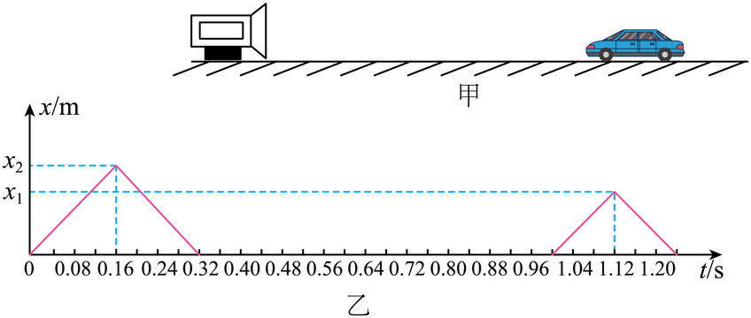

# Physics - 题目 1876

**ID**: ff4006df13234cdda1aa0556f7109c32
**年级**: Grade 8
**难度**: Medium-Hard
**题型**: Multiple-choice

## 题目
交通部门常用测速仪来检测车速，测速原理是测速仪前后两次发出并接收到被测车反射回的超声波信号，再根据两次信号的时间差，测出车速，如图甲。​​​​​​​‌某次测速中，测速仪发出与接收超声波的情况如图乙所示，x表示超声波与测速仪之间的距离，则该被测汽车速度是（假设超声波的速度为300m/s，且保持不变）（      ）

## 解答

1. 由题图可知，超声波第一次从测速仪发出到与汽车相遇经过的时间t_{1}=0.16s，测速仪距离汽车的最远距离
2. $x{{}_{1}}\equiv v{{}_{声}}t{{}_{1}}=300{\rm{m}}/{\rm{s}}\times 0.16{\rm{s}}=48{\rm{m}}$
3. 超声波第二次从测速仪发出到与汽车相遇经过的时间
4. $t{{}_{2}}=1.12{\rm{s}}-1{\rm{s}}=0.12{\rm{s}}$
5. 这段距离为
6. $x{{}_{2}}=v\times t{{}_{2}}=300{\rm{m}}/{\rm{s}}\times 0.12{\rm{s}}=36{\rm{m}}$
7. 汽车行驶的距离
8. $s=x{{}_{1}}-x{{}_{2}}=48{\rm{m}}-36{\rm{m}}=12{\rm{m}}$
9. 由题图知，汽车从第一次与超声波相遇到第二次与超声波相遇所用的时间
10. $t=1.12{\rm{s}}-0.16{\rm{s}}=0.96{\rm{s}}$
11. 则汽车行驶的速度为
12. $v=\frac {s}{t}=\frac {12{\rm{m}}}{0.96{\rm{s}}}=12.5{\rm{m}}/{\rm{s}}$
13. 故C符合题意，ABD不符合题意。

## 知识点

**中文**:
  - 速度的综合计算

**English**:
  - Comprehensive Velocity Calculations

---
