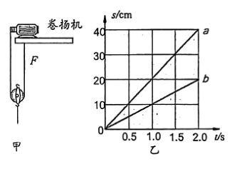

# Physics - 题目 2620

**ID**: 19f8a49d6b9747bd86c29242ee5c6a26
**年级**: Grade 8
**难度**: Medium-Hard
**题型**: Multiple-select

## 题目
如图甲所示，用一个动滑轮匀速竖直提升重为4500N的物体A，在卷扬机拉力F的作用下，物体A竖直移动的距离随时间变化的关系如图乙中图线a所示，卷扬机的恒定功率为1000W；用该装置匀速提升物体B时，物体B竖直移动的距离随时间变化的关系如图乙中图线b所示，不计绳重和轮与轴间的摩擦。​​​​​​​‌下列说法正确的是（      ）

## 解答

1. A．由图象可知，提升物体A时，物体A竖直移动的距离h=40cm，速度为
2. v_{物}= $\frac {s}{t}=\frac {40{\rm{c}}{\rm{m}}}{2.0{\rm{s}}}$ =20cm/s=0.2m/s
3. 故A正确；
4. B．拉力的功率
5. P= $\frac {W}{t}=\frac {Fs}{t}$ =Fv
6. 拉力的大小
7. $F=\frac {P}{v}=\frac {P}{2v{{}_{物}}}{\rm{=}}\frac {1000{\rm{W}}}{2\times 0.2{\rm{m}}{\rm{/}}{\rm{s}}}$ =2500N
8. 动滑轮的重力大小
9. G_{动}=2F-G_{物}=2×2500N-4500N=500N
10. 故B错误；
11. C．由图象可知，提升物体B时，2s内物体B上升的距离是20cm，绳子自由端移动的距离
12. s_{B}=2×20cm=0.4m
13. 绳子自由端的速度
14. $v{{}_{{\rm{B}}}}{\rm{=}}\frac {s{{}_{{\rm{B}}}}}{t}=\frac {0.4{\rm{m}}}{2{\rm{s}}}{\rm{=}}0.2{\rm{m}}{\rm{/}}{\rm{s}}$
15. 在这两次提升物体的过程中，卷扬机拉力F的功率保持不变，物体B时的拉力
16. $F{{}_{{\rm{B}}}}{\rm{=}}\frac {P}{v{{}_{{\rm{B}}}}}{\rm{=}}\frac {1000{\rm{W}}}{0.2{\rm{m}}{\rm{/}}{\rm{s}}}$ =5000N
17. 物体B受到的重力
18. G_{B}=2F_{B}-G_{动}=2×5000N-500N=9500N
19. 2秒内滑轮对物体B做的有用功为
20. W_{有}=G_{B}h=9500N×0.2m=1900J
21. 故C正确；
22. D．提升物体B时拉力做的总功
23. W_{总}=F_{B}s_{B}=5000N×0.4m=2000J
24. 提升物体B时动滑轮的机械效率为
25. $η{\rm{=}}\frac {W{{}_{有}}}{W{{}_{总}}}{\rm{=}}\frac {1900{\rm{J}}}{2000{\rm{J}}}$ =95%
26. 故D正确。
27. 故选ACD。

## 知识点

**中文**:
  - 功、功率、机械效率的综合计算
  - 动滑轮拉力的计算

**English**:
  - Comprehensive Calculation of Work, Power, and Efficiency
  - Calculating Pulling Force of Movable Pulleys

---
