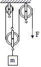

# Physics - 题目 448

**ID**: 6287679324e7486f8e60f69da598a011
**年级**: Grade 8
**难度**: Medium-Hard
**题型**: Multiple-select

## 题目
用如图所示的滑轮组竖直匀速提升质量为 $m$ 的物体，绳子的拉力大小为 $F$ ，在时间 $t$ 内物体上升的高度为 $h$ ，滑轮组的机械效率为 $η$ ，每个滑轮重力大小均为 $G$ （绳子与滑轮间摩擦不能忽略、不计绳子重力）。​​​​​​​‌下列说法正确的是（      ）

## 解答

1. A．忽略摩擦时，每个滑轮重力大小为
2. $G=3F-mg$
3. 但绳子与滑轮间摩擦不能忽略，故A错误；
4. B．若仅增加提升物体的重力，额外功不变，有用功增大，有用功在总功中所占的比例增大，机械效率增大，故B正确；
5. C．物体质量增大到5m时，有用功变成5倍，额外功包括动滑轮自重和摩擦力，克服动滑轮的重力所做的额外功不变，即使克服摩擦所做的额外功增大，但总的额外功不会变成5倍，有用功和额外功之和不可能变成5倍，根据W=Fs，拉力大小也不可能变成原来的5倍，故C错误；
6. D．机械效率为
7. $η=\frac {W{{}_{有}}}{W{{}_{有}}+W{{}_{额}}}=\frac {mgh}{mgh+W{{}_{额}}}$
8. 故额外功
9. $W{{}_{额}}=\frac {mgh-ηmgh}{η}=\frac {1-η}{η}mgh$
10. 因W_{有}=mgh，W_{总}=3Fh，那么额外功
11. W_{额}=W_{总}-W_{有}=3Fh-mgh=h(3F-mg)
12. 故D正确。
13. 故选BD。

## 知识点

**中文**:
  - 增大或减小机械效率的方法
  - 滑轮组及其工作特点
  - 滑轮（组）的机械效率及其计算

**English**:
  - Methods to Increase or Decrease Mechanical Efficiency
  - Pulley Systems and Operating Characteristics
  - Mechanical Efficiency of Pulleys and Calculations

---
