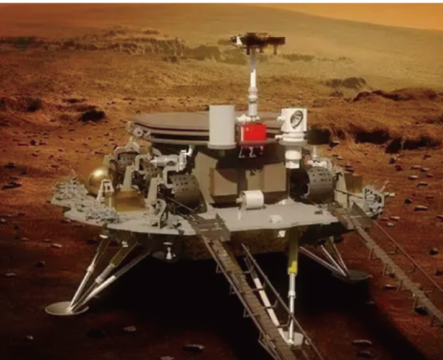
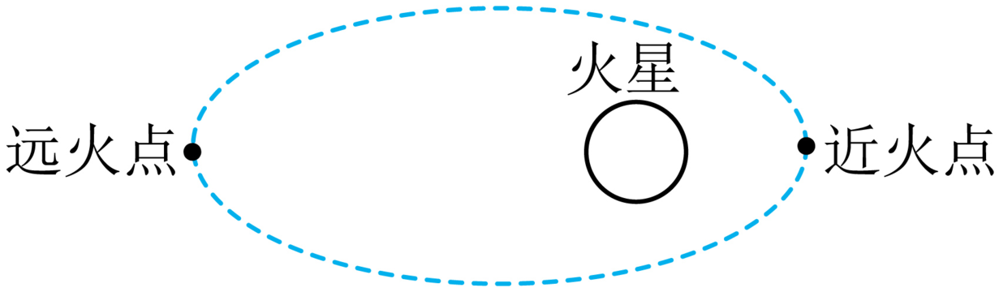

# Physics - 题目 1832

**ID**: 6dd55dcaad0e4214a2885fc1d5f3340c
**年级**: Grade 8
**难度**: Medium-Hard
**题型**: Science Reading

## 题目
阅读下面材料，回答问题。​​​​​​​‌登陆火星仰望星空，我们追梦不止2021年5月15日，我国发射的“祝融号”火星车登陆火星表面，如图所示。登陆一颗陌生的星球，大体分为“绕”“着”“巡”三步。“绕”：探测器经过漫长的旅程，实现对登陆星球的环绕飞行。“着”：探测器着陆星球表面的过程。“巡”：探测器到达星球表面后，放出巡视车，完成对星球表面的拍摄及土壤分析等工作。其中最困难的一步就是“着”，这个过程中要使探测器的速度在短短的几分钟内降至零，通常要先后经历“气动减速”“降落伞减速”“动力减速”三个阶段。火星是太阳系中与地球最相似的行星，表面有大气层，温度适宜，火星表面引力为地球表面引力的0.4倍。（1）探测器经过漫长的旅程，实现对火星的环绕飞行。探测器环绕火星运动的轨道是一个椭圆，如图乙所示。当探测器运行到“近火点”时，它的动能（选填“最大”或“最小”）；（2）若着陆过程中只利用火星大气的阻力对探测器进行气动减速，探测器受到的大气阻力大小随探测器速度的增大而增大，探测器沿直线下落，且它距离火星表面足够高，可以推断：火星探测器着陆火星前的运动状态一定是直线运动（选填“加速”“减速”或“匀速”）；（3）利用“降落伞减速”时，打开降落伞，探测器受到的向上的力大于它的重力，那么打开降落伞时，探测器会（选填“向上”或“向下”）运动；（4）在地球上质量为40kg的杠铃，带去火星上，在火星上杠铃的重力为N。

## 解答

1. （1）当探测器运行到“近火点”时，它的质量不变，速度最大，它的动能最大。
2. （2）探测器受到的大气阻力大小随探测器速度的增大而增大，探测器开始沿直线下落时，大气的阻力要小于探测器的重力，所有探测器在重力的作用下向下做加速运动；随着速度的增大，受到大气的阻力越大，当阻力等于重力时，探测器受力平衡，将做匀速直线运动，所以可以推断：火星探测器着陆火星前的运动状态一定是匀速直线运动。
3. （3）利用降落伞减速时，若开伞的瞬间，探测器受到的向上的力大于它的重力，由于惯性，探测器仍会向下运动。
4. （4）在地球上质量为40kg的杠铃的重力G=mg=40kg×10N/kg=400N，火星表面引力为地球表面引力的0.4倍，则在火星上杠铃的重力G'=0.4G=0.4×400N=160N。

## 知识点

**中文**:
  - 动能的变化问题
  - 重力公式的应用
  - 生活中的惯性现象

**English**:
  - Changes in Kinetic Energy
  - Application of Gravity Formula
  - Inertia Phenomena in Daily Life

---
