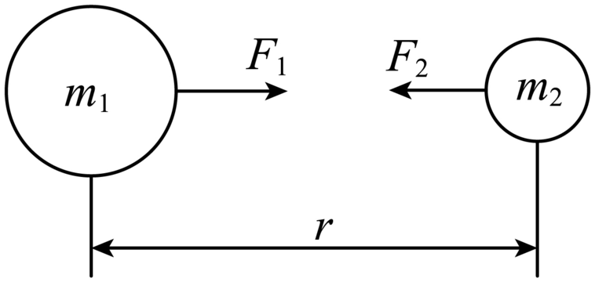

# Physics - 题目 1262

**ID**: f067dcb84acf4f0f809287b07987809d
**年级**: Grade 8
**难度**: Medium-Hard
**题型**: Science Reading

## 题目
阅读短文，回答问题万有引力牛顿发现的万有引力定律是17世纪自然科学最伟大的成果之一，它把地面上物体运动的规律和天体运动的规律统一了起来，对以后物理学和天文学的发展具有深远的影响。​​​​​​​‌如图所示，任意两个物体间都有通过连心线方向上相互吸引的力，这种力叫万有引力，该引力大小与它们质量的乘积成正比，与它们中心之间距离的平方成反比，与两物体的组成和其间介质种类无关，万有引力的计算公式为 $F=k\frac {m{{}_{1}}m{{}_{2}}}{r{^{2}}}$ ，其中F表示两个物体之间的引力，k表示万有引力常量，m_{1}表示物体1的质量，m_{2}表示物体2的质量，r表示两个物体中心之间的距离，两个质量为1kg的物体在相距1米时的吸引力约为6.67×10^{-11}N。太阳对地球的引力使地球不能离开太阳，地球对其上物体的引力使物体不能离开地球。要离开地球，必须借助运载火箭发射，2018年12月8日，我国成功发射“嫦娥四号”探测器。地球上物体受到的重力是万有引力的表现，重力大小几乎等于物体与地球间的万有引力。跟地球一样，在其他所有星球上，物体也会由于星球对它的吸引而受到指向该星球球心的力。如果我们把这些力也叫重力的话，那么，物体在某星球上受到的重力不仅跟物体本身的质量有关，还跟该星球的质量、半径等因素有关，由于不同的星球质量和半径各不相同，所以，同一个物体在不同星球上受到的重力并不相同。（已知 $g{{}_{月}}=\frac {1}{6}g{{}_{地}}$ ）（1）下列现象的成因，与万有引力无关的是（      ）

## 解答

1. （1）A．月球在地球的引力作用下，绕地球旋转，月球绕地球运动而不能飞离地球现象与万有引力有关，故A不符合题意；
2. B．铁丝很难被拉断是因为分子之间存在引力，与万有引力无关，故B符合题意；
3. C．行星在太阳的引力作用下，绕太阳旋转，行星绕太阳运动而不能飞离太阳现象与万有引力有关，故C不符合题意；
4. D．熟透了的苹果从树上落向地面，是因为苹果受到地球的引力才落下，所以与万有引力有关，故D不符合题意。
5. （2）苹果的重心是指其质量分布的几何中心，当苹果从树上脱落并下落时，其重心会随着苹果整体位置的变化而逐渐降低，直至到达地面。
6. （3）万有引力大小与它们质量的乘积成正比，与它们中心之间距离的平方成反比，任意两个同学之间也有引力，但两个同学的质量较小，导致引力较小，使得他们的行动却几乎没有受到影响。
7. （4）万有引力大小与它们质量的乘积成正比，与它们中心之间距离的平方成反比，“嫦娥四号”探测器由地球飞向月球的过程中，探测器与地球之间的距离不断变大，所以地球对探测器的引力将变小，地球上物体受到的重力是万有引力的表现，重力大小几乎等于物体与地球间的万有引力，则探测器的重力也变小。
8. （5）两个质量为1kg的物体在相距1米时的吸引力约为6.67×10^{-11}N，根据 $F=k\frac {m{{}_{1}}m{{}_{2}}}{r{^{2}}}$ ，万有引力常量为 $k=\frac {Fr{^{2}}}{m{{}_{1}}m{{}_{2}}}=\frac {6.67\times 10{^{-11}}{\rm{N}}\times {\left({1{\rm{m}}}\right)^{2}}}{1{\rm{k}}{\rm{g}}\times 1{\rm{k}}{\rm{g}}}=6.67\times 10{^{-11}}{\rm{N}}\centerdot {\rm{m}}{^{2}}/{\rm{k}}{\rm{g}}{^{2}}$
9. 质量为1kg的物体在地球表面受到的重力约为10N，如果地球半径约为6.67×10^{6}m，则地球质量约为 $m{{}_{地}}=\frac {F{{}_{0}}r{{}_{0}}{^{2}}}{km{{}_{0}}}=\frac {10{\rm{N}}\times {\left({6.67\times 10{^{6}}{\rm{m}}}\right)^{2}}}{6.67\times 10{^{-11}}{\rm{N}}\centerdot {\rm{m}}{^{2}}/{\rm{k}}{\rm{g}}{^{2}}\times 1{\rm{k}}{\rm{g}}}=6.67\times 10{^{24}}{\rm{k}}{\rm{g}}$
10. （6）由 $F=k\frac {m{{}_{1}}m{{}_{2}}}{r{^{2}}}$ ，该物体在地球上的重力为 $G{{}_{地}}=F{{}_{地}}=k\frac {m{{}_{地}}m}{r{{}_{地}}{^{2}}}$
11. 该物体在海王星上的重力为 $G{{}_{海王星}}=F{{}_{海王星}}=k\frac {m{{}_{海王星}}m}{r{{}_{海王星}}{^{2}}}=k\times \frac {17m{{}_{地}}m}{{\left({4r{{}_{地}}}\right)^{2}}}=\frac {17}{16}k\frac {m{{}_{地}}m}{r{{}_{地}}{^{2}}}＞G{{}_{地}}$
12. 即同一个物体在海王星上受到的重力大于在地面上受到的重力。

## 知识点

**中文**:
  - 重力公式的应用

**English**:
  - Application of Gravity Formula

---
