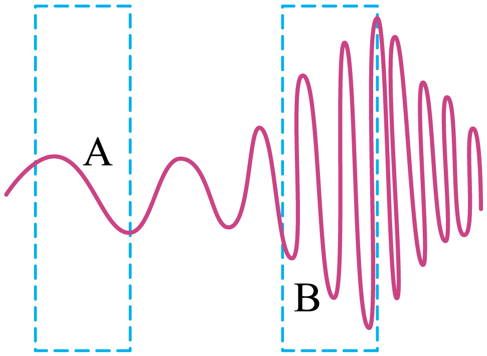

# Physics - 题目 848

**ID**: 0207a9b048c84cf78955d56001362013
**年级**: Grade 8
**难度**: Medium
**题型**: Multiple-choice

## 题目
市场上有一种变声器，可以将男声变成女声，某段声音波形图变化如图所示，变声前是A段，变声后是B段，则变化后的声音（      ）​​​​​​​‌

## 解答

1. 由图可知，B段的振动频率大于A段，B段的音调高；B段的振动幅度大于A段，B段的响度大，A符合题意，B、C、D不符合题意。

## 知识点

**中文**:
  - 响度与振幅的关系
  - 音调与频率的关系

**English**:
  - Relationship between Loudness and Amplitude
  - Relationship between Pitch and Frequency

---
