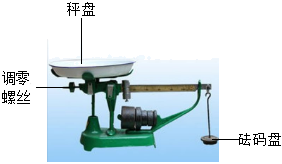

# Physics - 题目 1775

**ID**: 0f7ce706f1974c528ad2effbf14c1eed
**年级**: Grade 8
**难度**: Medium
**题型**: Multiple-choice

## 题目
商店常用如图所示案秤称量货物的质量，有关称量的说法正确的是（      ）​​​​​​​‌

## 解答

1. A．案秤不是等臂杠杆，货物的质量不等于砝码的质量，故A错误；
2. B．若砝码磨损了，则称量时砝码需放在刻度偏大的位置，案秤才能平衡，所以称量结果与实际质量相比偏大，故B错误；
3. C．称量时，若在秤盘下粘了一块泥巴，称量的示数应该等于物体的质量和泥巴质量的和，称量的结果比实际质量大，故C错误；
4. D．若调零螺母的位置比正确位置向右多旋进一些，则秤盘中需放一定质量的物体，才能在游砣指零情况下使案秤平衡。然后再把待测货物放入秤盘中，平衡时，货物质量等于称量质量，此时称量质量小于秤盘中两物体质量之和，所以称量结果与实际质量相比偏小，故D正确。

## 知识点

**中文**:
  - 质量的测量与天平的使用

**English**:
  - Measurement of Mass and Use of Balance

---
