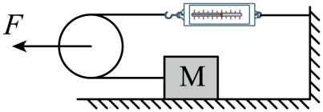

# Physics - 题目 238

**ID**: 149588bbd4c44005ae1769ab9e219ad2
**年级**: Grade 8
**难度**: Medium
**题型**: Multiple-choice

## 题目
如图所示，不计动滑轮与绳之间的摩擦和重力，在水平拉力F的作用下，物体M以0.​​​​​​​‌2m/s的速度向左匀速直线运动，弹簧秤的示数为20N，以下正确的是（      ）①M受到地面的摩擦力为20N②M受到地面摩擦力水平向左③拉力F的功率为8W④M受到的重力与地面对M的支持力是一对平衡力

## 解答

1. ①②弹簧秤的示数为20N，即绳子对弹簧秤的拉力为20N，因同一根绳子各处的拉力大小相同，所以绳子对物体M的拉力也为20N；物体M向左匀速直线运动，其受到的拉力和摩擦力是一对平衡力，所以M受到地面的摩擦力f＝F_{拉}＝20N，方向与物体运动方向相反，即水平向右；故①正确，②错误；
2. ③不计动滑轮与绳之间的摩擦和重力，由图知，拉力作用在动滑轮轴上，与右侧两段绳子的拉力平衡，则拉力的大小为F＝2F_{示}＝2×20N＝40N，由图知，n＝2，且拉力F作用在动滑轮轴上，费力但省一半的距离，则拉力端移动的速度是物体移动速度的 $\frac {1}{2}$ ，故拉力端移动的速度v_{拉力端}＝ $\frac {1}{2}{\rm \mathit{v}＝}$  $\frac {1}{2}{\rm ×0.2m}$ /s＝0.1m/s，拉力的功率为P＝Fv_{拉力端}＝40N×0.1m/s＝4W，故③错误；
3. ④M受到的重力与地面对M的支持力大小相同、方向相反、在同一直线上、作用在同一个物体上，所以二力是一对平衡力，故④正确；
4. 综上可知，只有①④正确。

## 知识点

**中文**:
  - 二力平衡的条件及其应用
  - 功率的计算和估算
  - 动滑轮及其工作特点

**English**:
  - Conditions and Applications of Two-Force Equilibrium
  - Calculation and Estimation of Power
  - Movable Pulleys and Operating Characteristics

---
