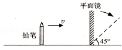

# Physics - 题目 2384

**ID**: 189244711b1449aaa361c3b9c0159e51
**年级**: Grade 8
**难度**: Medium
**题型**: Multiple-choice

## 题目
如图所示，平面镜竖直放置在水平面上，一支直立的铅笔从平面镜前40cm处，以5cm/s的水平速度垂直向平面镜匀速靠近，下列说法正确的是（      ）​​​​​​​‌

## 解答

1. A．平面镜所成的像与物体大小是相等的，物体大小不变，像的大小也不变，故A错；
2. B．经过2s，物体向前移动了10cm，铅笔到平面镜的距离变为30cm，此时铅笔与它的像的距离变为60cm，故B错；
3. C．像相对于镜面的速度与物体相对于镜面的速度是相等的为5cm/s，故C错；
4. D．根据平面镜成像与物体的对称性可知，若平面镜顺时针转至图中虚线位置，铅笔的像将与铅笔垂直，故应选D．

## 知识点

**中文**:
  - 平面镜成像的特点、原理及现象

**English**:
  - Characteristics, Principles, and Phenomena

---
