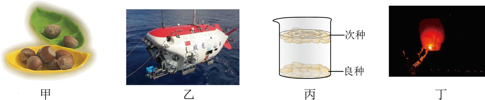

# Physics - 题目 294

**ID**: 1f2580106d34441d8662ebea3cba549f
**年级**: Grade 8
**难度**: Medium
**题型**: Multiple-choice

## 题目
如图所示，下列说法中不正确的是（      ）​​​​​​​‌

## 解答

1. A．图甲中橡皮泥船采用空心的办法来增加排开水的体积，来增加载货量，故A正确，不符合题意；
2. B．图乙潜水艇在海中悬浮和漂浮时排开水的体积不同，所受的浮力不同，故B错误，符合题意；
3. C．图丙盐水选种时，由浮沉条件得，沉入水底的良种浮力小于重力，浮在水面的次种浮力等于重力，故C正确，不符合题意；
4. D．图丁加热孔明灯内空气，内部空气密度比外部空气密度小到一定程度，孔明灯受到的浮力大于重力，孔明灯上升，故D正确，不符合题意。

## 知识点

**中文**:
  - 物体的浮沉条件及其应用
  - 阿基米德原理的应用

**English**:
  - Floating/Sinking Conditions and Applications
  - Applications of Archimedes' Principle

---
