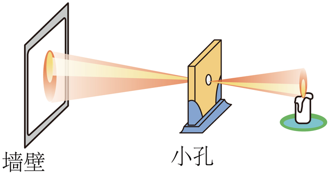

# Physics - 题目 100

**ID**: 34bc98e8a5b74cb797c3e73ccef2fc5c
**年级**: Grade 8
**难度**: Medium
**题型**: Multiple-choice

## 题目
早在战国时期，著名教育家、思想家墨子就在研究小孔成像的现象。​​​​​​​‌如图所示，用蜡烛作为光源，在木板上钻一个小孔，发现光线透过小孔在墙壁上形成倒立的像，下列说法正确的是（      ）

## 解答

1. A．物体发出或反射的光线在同种均匀介质中传播时，穿过小孔后会在小孔后面的屏上成倒立的实像，小孔成像有力地证明了光在同种均匀介质中沿直线传播，故A正确；
2. B．小孔成像成的是物体的像，与小孔的形状无关，故B错误；
3. C．保持蜡烛和墙的位置不变，将木板向靠近墙的方向移动，因为成像的大小取决于像到小孔的距离，则木板与小孔距离越小，像也越小，故C错误；
4. D．根据光的直线传播知识可知，蜡烛在墙上成的像是倒立的实像，故D错误。

## 知识点

**中文**:
  - 光沿直线传播的应用

**English**:
  - Applications of Rectilinear Propagation

---
