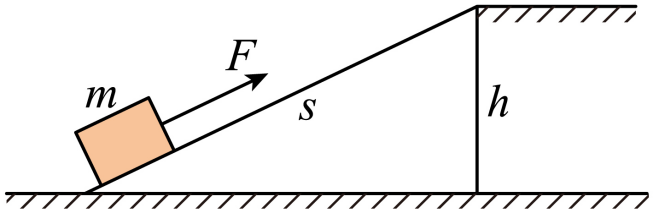

# Physics - 题目 37

**ID**: 39062f9cadb6496ab67eca061b3b209e
**年级**: Grade 8
**难度**: Medium
**题型**: Multiple-choice

## 题目
如图所示，木板长为s，工人师傅用力F将质量为m的货箱沿木板从地面匀速拉到高为h的车上。​​​​​​​‌下列说法正确的是（      ）

## 解答

1. A．拉力F做的功为W_{总}=Fs，故A错误；
2. B．拉力F做的有用功为W_{有}=Gh=mgh，额外功为W_{额}=W_{总}-W_{有}=Fs-mgh，则货箱受到的摩擦力为 $f=\frac {W{{}_{额}}}{s}=\frac {Fs-mgh}{S}=F-\frac {mgh}{s}$ ，故B正确；
3. C．只增加木板的长度，斜面的高度不变，根据W_{有}=Gh=mgh，可知，克服货箱重力做的功不变，故C错误；
4. D．根据 $η=\frac {W{{}_{有}}}{W{{}_{总}}}=\frac {mgh}{Fs}$ ，可知，斜面的机械效率与匀速拉动物体的速度无关，以更快地速度匀速拉货箱，斜面的机械效率不变，故D错误。

## 知识点

**中文**:
  - 斜面的机械效率及其计算
  - 有用功、额外功和总功的计算
  - 机械效率的大小比较

**English**:
  - Mechanical Efficiency of Inclined Planes and Calculations
  - Calculation of Useful, Extra, and Total Work
  - Comparing Mechanical Efficiency

---
