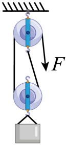

# Physics - 题目 1398

**ID**: 469f99edcde24aafa38f93df6498b456
**年级**: Grade 8
**难度**: Medium
**题型**: Multiple-choice

## 题目
在老旧小区改造中，工人利用滑轮组将重380N的建筑材料提升到楼顶，如图所示。​​​​​​​‌已知工人对绳子的拉力为200N，建筑材料在5s内匀速上升5m，不计绳重及摩擦。此过程中，下列说法正确的是（      ）

## 解答

1. B．建筑材料上升的高度h=5m，所以有用功为 $W{{}_{有}}=Gh=380{\rm{N}}\times 5{\rm{m}}=1900{\rm{J}}$ ，故B错误；
2. C．由图可知，绳子股数n=2，绳端移动的距离为s=2h=2×5m=10m，工人所用拉力的功为
3. $W{{}_{总}}=Fs=200{\rm{N}}\times 10{\rm{m}}=2000{\rm{J}}$ ，拉力的功率为 $P=\frac {W{{}_{总}}}{t}=\frac {2000{\rm{J}}}{5{\rm{s}}}=400{\rm{W}}$ ，故C错误；
4. A．不计绳重及摩擦，所做的额外功为 $W{{}_{额}}=W{{}_{总}}-W{{}_{有}}=2000{\rm{J}}-1900{\rm{J}}=100{\rm{J}}$ ，动滑轮所受重力为 $G{{}_{动}}=\frac {W{{}_{额}}}{h}=\frac {100{\rm{J}}}{5{\rm{m}}}=20{\rm{N}}$ ，故A错误；
5. D．滑轮组的机械效率为 $η=\frac {W{{}_{有}}}{W{{}_{总}}}\times 100\%=\frac {1900{\rm{J}}}{2000{\rm{J}}}\times 100\%=95\%$ ，故D正确。

## 知识点

**中文**:
  - 功、功率、机械效率的综合计算
  - 滑轮组及其工作特点

**English**:
  - Comprehensive Calculation of Work, Power, and Efficiency
  - Pulley Systems and Operating Characteristics

---
