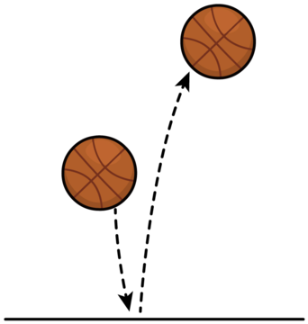

# Physics - 题目 1649

**ID**: 4a1076a1daf747d9b25c8e6f13325317
**年级**: Grade 8
**难度**: Medium
**题型**: Multiple-choice

## 题目
体育课上，小阳将篮球用力掷向地面，篮球碰到地面后向上反弹，反弹后运动到的最高点比掷出篮球的位置更高，如图所示。​​​​​​​‌下列判断正确的是（      ）

## 解答

1. A．篮球从手中下落直到接触地面的瞬间，球的高度越来越小，速度越来越大，由此可以判断球的重力势能逐渐减小，动能逐渐增大，重力势能转化为动能，所以篮球刚刚脱离手时，它的动能不是最大的故A错误；
2. B．篮球离开手到达最高点的过程中，篮球由于克服摩擦力做功，一部分的机械能会转化成内能，所以篮球在最高点的机械能小于它刚刚脱离手时的机械能故B错误；
3. C．篮球从脱离手到它碰到地面的过程中，离地面的高度减小，重力势能减小；速度增大，动能增大，重力势能转化成动能故C正确；
4. D．篮球从地面反弹到最高点的过程中，离地面的高度增大，重力势能增大故D错误。

## 知识点

**中文**:
  - 动能和势能的转化
  - 动能的变化问题
  - 重力势能的变化问题
  - 机械能的变化问题

**English**:
  - Transformation between Kinetic and Potential Energy
  - Changes in Kinetic Energy
  - Changes in Gravitational Potential Energy
  - Changes in Mechanical Energy

---
