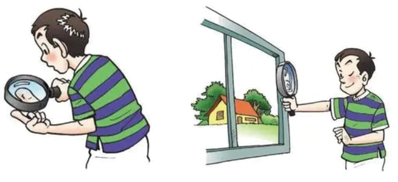

# Physics - 题目 1405

**ID**: 59f927bb62304c6093b9f1251313dc67
**年级**: Grade 8
**难度**: Medium
**题型**: Multiple-choice

## 题目
如图所示，物理课上，同学们用凸透镜观察周围的物体，透过凸透镜不能看到的像是（      ）​​​​​​​‌

## 解答

1. A．当物距小于一倍焦距时，成正立、放大的虚像，应用于放大镜，故A不符合题意；
2. B．凸透镜的成像情况没有能成正立缩小的像，故B符合题意；
3. C．当u=2f时，成倒立、等大的实像，故C不符合题意；
4. D．当u>2f，成倒立、缩小的实像，应用于照相机，故D不符合题意。

## 知识点

**中文**:
  - 凸透镜成像规律的应用

**English**:
  - Applications of Convex Lens Imaging

---
