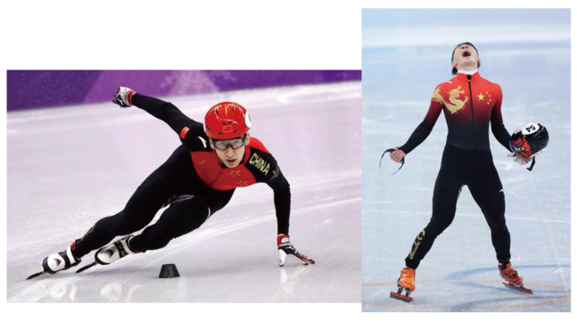

# Physics - 题目 1005

**ID**: 620c84de7f0e4ce99084df5b6f0c07fa
**年级**: Grade 8
**难度**: Medium
**题型**: Multiple-choice

## 题目
在2022北京冬奥会短道速滑男子1000米比赛中，中国选手任子威获得金牌。​​​​​​​‌图甲是他正全力通过弯道、图乙是他获胜后站立在水平赛场中央大声欢呼的情形，下列说法正确的是（      ）

## 解答

1. A．通过弯道过程中，他的运动状态发生改变，他不处于平衡状态，故A错误；
2. B．站立时，他受到的重力和他对冰面的压力两个力的方向相同，故不是相互作用力，故B错误；
3. C．站立时他受到的重力和他对冰面的压力这两个力的方向相同，故不是平衡力，故C错误；
4. D．图甲中他的手对冰面的压力与冰面对他的手的支持力，这两个力大小相等，方向相反，施力物体和受力物体互为彼此，同时产生，同时消失，故是一对相互作用力，故D正确。

## 知识点

**中文**:
  - 平衡力与相互作用力的区别

**English**:
  - Difference between Equilibrium Forces and Interaction Forces

---
