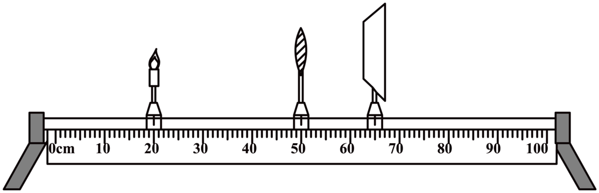

# Physics - 题目 1096

**ID**: 67eea66874e84bbea68b749c1730a991
**年级**: Grade 8
**难度**: Medium
**题型**: Multiple-choice

## 题目
如图所示，小明将蜡烛、凸透镜、光屏依次摆放在光具座上，光屏上成清晰的烛焰像，然后进行了如下的判断和操作（每次操作均在如图基础上），下列说法正确的是（      ）​​​​​​​‌

## 解答

1. A．图示中，物距大于像距，在光屏上成倒立、缩小的实像，物体经显微镜的物镜成倒立、放大的实像，两者的原理不同，故A错误；
2. B．由图示知，刻度尺的分度值为1cm，蜡烛到凸透镜的距离，即物距u=50.0cm-20.0cm=30.0cm，像距v=65.0cm-50.0cm=15.0cm，由于物距大于像距，成倒立缩小的实像，所以有 $2f<30.0{\rm{c}}{\rm{m}}$ ， $f<15.0{\rm{c}}{\rm{m}}<2f$ ，解得7.5cm<f<15.0cm。故B正确；
3. C．蜡烛逐渐靠近凸透镜，移动光屏，在光屏上的实像由于物距变小，像会一直变大。直到光屏上不能成清晰的像，故C错误；
4. D．将小明的眼镜放在蜡烛和透镜之间，向左移动光屏，才可再次成清晰的像，即放入眼镜后，像距变小，则眼镜对蜡烛的光有会聚作用，将同样位置发出的同样的光先会聚，再经凸透镜，折射光会提前会聚成像，所以小明的眼镜是凸透镜，即是远视眼镜，故D错误。

## 知识点

**中文**:
  - 凸透镜成像规律的应用
  - 近视眼的成因与矫正办法

**English**:
  - Applications of Convex Lens Imaging
  - Causes and Correction of Myopia (Nearsightedness)

---
