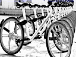

# Physics - 题目 2161

**ID**: 694c646d3675423f9b7963554abfec0a
**年级**: Grade 8
**难度**: Medium
**题型**: Multiple-choice

## 题目
疫情期间，哈尔滨更多的市民选择了共享单车这种出行方式，当人们在平直路面上匀速向前骑行时，以下说法中错误的是（      ）​​​​​​​‌

## 解答

1. A．人们在平直路面上向前骑行时，水平方向上自行车受到向前动力和向后的阻力，自行车又保持匀速直线运动，所以动力和阻力是一对平衡力，故A正确，不符合题意；
2. B．根据牛顿第一定律，如果在骑行过程中单车所受的外力全部消失，那么单车会保持匀速直线运动，故B错误，符合题意；
3. C．人对车的压力的施力物体是人，受力物体是车，车对人的支持力的施力物体是车，受力物体是人，故人对车的压力和车对人的支持力是一对相互作用力，故C正确，不符合题意；
4. D．人和车看成一个整体的受力情况是受到人和车的总重力与地面对人和车的支持力，由于人和车做匀速直线运动，所以人和车受到的重力与地面对人和车的支持力是一对平衡力，故D正确，不符合题意。
5. 故选B。

## 知识点

**中文**:
  - 二力平衡的概念及平衡状态的判断
  - 力的作用是相互的
  - 牛顿第一定律的理解与应用

**English**:
  - Concept and Judgment of Equilibrium
  - Interaction of Forces
  - Understanding and Application of Newton's First Law

---
