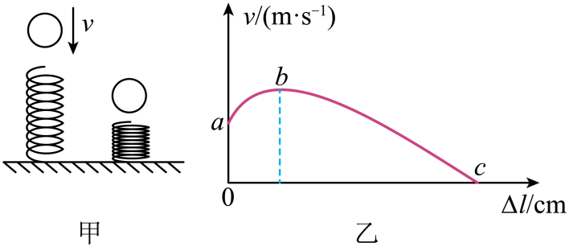

# Physics - 题目 2502

**ID**: 6e806536318643d1a0c46d3a62c004ec
**年级**: Grade 8
**难度**: Medium
**题型**: Multiple-choice

## 题目
如图甲所示，小球从某高度处由静止下落到竖直放置的弹簧上并压缩弹簧。​​​​​​​‌从小球刚接触弹簧到弹簧被压缩到最短的过程中，小球的速度v和弹簧被压缩的长度 $\Delta l$ 之间的关系如图乙所示，其中b为曲线最高点。不计空气阻力，弹簧一直是弹性形变。在弹簧向下被压缩的过程中，下列说法错误的是（      ）

## 解答

1. A．小球从某高度处由静止下落到竖直放置的弹簧上并压缩弹簧，从小球刚接触到弹簧到将弹簧压缩最短的过程中，弹簧形变程度逐断变大，所以小球受到弹力也逐渐变大，故A不符合题意；
2. B．在小球从a到b的过程中,重力大于弹簧的弹力,合力向下，小球下落速度增大,但随着弹簧被压缩，向上的弹力逐渐增大,当增大到与重力相等(即小球到达b点)时,速度就不再增大,此时速度最大，动能最大,故B不符合题意；
3. C．小球从a到b的过程中，重力大于弹簧的弹力,合力等于重力减去弹力，由于弹簧的弹性形变变大，弹力在增加，所以小球受到的合力减小，故C不符合题意；
4. D．从b到最低点的过程，小球的高度降低，重力势能减小，速度减小，动能减少，弹簧的形变程度增大，弹性势能增大，所以重力势能和动能同时转化为弹性势能，小球的机械能减小，故D错误，符合题意。

## 知识点

**中文**:
  - 力与运动的关系
  - 力的合成与应用
  - 动能的变化问题
  - 动能和势能的转化
  - 机械能守恒

**English**:
  - Relationship between Force and Motion
  - Composition of Forces and Applications
  - Changes in Kinetic Energy
  - Transformation between Kinetic and Potential Energy
  - Conservation of Mechanical Energy

---
