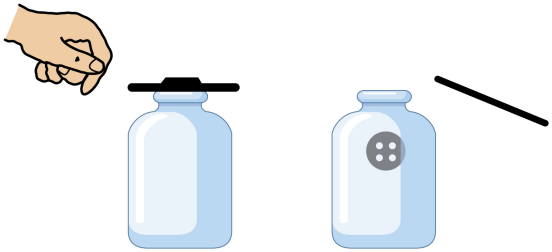

# Physics - 题目 1435

**ID**: 6f0a20b65a9343ecb5184e582756f6d0
**年级**: Grade 8
**难度**: Medium
**题型**: Multiple-choice

## 题目
如图所示，把卡片放在瓶口上面，再将光滑的扣子放在卡片上静止。​​​​​​​‌用手指使劲弹一下卡片，卡片飞出去，但扣子却落入了瓶中。关于这个游戏说法正确的是（      ）

## 解答

1. A．扣子静止时对卡片的压力与扣子受的支持力作用在两个物体上，是一对相互作用力，故A错误；
2. B．压力一定时，接触面越光滑，摩擦力越小，用光滑的扣子是为了减小扣子与卡片之间的摩擦力，故B错误；
3. C．卡片受到了手指对其力的作用，由静止变为运动被弹开，说明力可以改变物体的运动状态，故C正确；
4. D．扣子不随卡片飞出是因为扣子没有受到弹力，由于惯性要保持原来的静止状态，所以掉入瓶中，惯性不是力，不能说受到惯性作用，故D错误。

## 知识点

**中文**:
  - 力的作用效果
  - 生活中的惯性现象
  - 平衡力与相互作用力的区别
  - 增大或减小摩擦的方法

**English**:
  - Effects of Force
  - Inertia Phenomena in Daily Life
  - Difference between Equilibrium Forces and Interaction Forces
  - Methods to Increase or Decrease Friction

---
