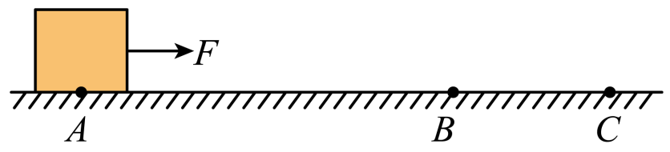

# Physics - 题目 1893

**ID**: 741a5b9ae3804495b9c2309fe9e265ab
**年级**: Grade 8
**难度**: Medium
**题型**: Multiple-choice

## 题目
如图所示，在粗糙程度不变的水平面上，用5N的拉力拉着重为10N的物块，从A点匀速直线运动到B点，从B点开始将拉力增大为10N，从C点开始撤去拉力。​​​​​​​‌则下列说法正确的是（      ）

## 解答

1. A．物块在AB段匀速直线运动，水平方向上受到平衡力作用，物块受到的拉力和摩擦力是一对平衡力，大小相等，拉力为5N，摩擦力大小等于5N，故A错误；
2. BC．物块从AB段运动到BC段时，接触面所受压力和接触面的粗糙程度均不变，摩擦力大小不变，即物块在AC段所受到的摩擦力始终不变，在BC段时，摩擦力仍为5N，但拉力增大为10N，物块受到的拉力大于摩擦力，物块做加速运动，由 $P=\frac {W}{t}=\frac {Fs}{t}=Fv$ ，可知，拉力不变，速度变大，所以拉力的功率变大，故B错误，C正确；
3. D．在C点撤去拉力后，物块会因为具有惯性继续向前运动，同时物块因为受到摩擦阻力的作用做的是减速运动，物块在摩擦力方向上通过了距离，所以物块克服摩擦力做功，故D错误。

## 知识点

**中文**:
  - 二力平衡的条件及其应用
  - 滑动摩擦力的大小
  - 滑动摩擦力大小的影响因素
  - 力做功的必要条件
  - 功率大小的比较

**English**:
  - Conditions and Applications of Two-Force Equilibrium
  - Magnitude of Sliding Friction
  - Factors Affecting Sliding Friction
  - Necessary Conditions for Work
  - Comparing Magnitude of Power

---
