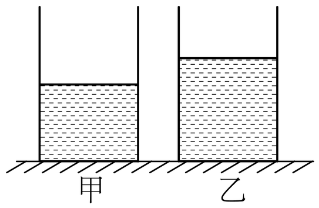

# Physics - 题目 2663

**ID**: 8029027197944196aad1f6a6a673785f
**年级**: Grade 8
**难度**: Medium
**题型**: Multiple-choice

## 题目
两个完全相同的圆柱形容器静止放在水平桌面上，其中分别装有质量相等的水和酒精，液面高度如图所示。​​​​​​​‌甲容器中液体对容器底部的压强和压力分别为p_{1}和F_{1}，乙容器中液体对容器底部的压强和压力分别为p_{2}和F_{2}，甲容器对桌面的压强和压力分别为p_{1}′和F_{1}′，乙容器对桌面的压强和压力分别为p2′和F_{2}′，则下列判断中正确的是（      ）

## 解答

1. 分别装有质量相等的水和酒精，液体对容器底的压力等于液柱的重力，由G=mg知道，当质量相同时，故
2. F_{1}=F_{2}
3. 由于两个完全相同的圆柱形容器，所以，液柱的受力面积S相同，由 $p=\frac {F}{S}$  知道，液柱对容器底的压强
4. p_{1}=p_{2}
5. 容器对水平桌面的压力等于容器和液体的重力，故两容器对桌面的压力相等，即
6. F_{1}′=F_{2}′
7. 由 $p=\frac {F}{S}$  知道，两容器对桌面的压强相等，即
8. p_{1}′=p_{2}′
9. 综上所述，只有D正确。
10. 故选D。

## 知识点

**中文**:
  - 压强大小的比较
  - 重力公式的应用

**English**:
  - Comparing Pressure
  - Application of Gravity Formula

---
