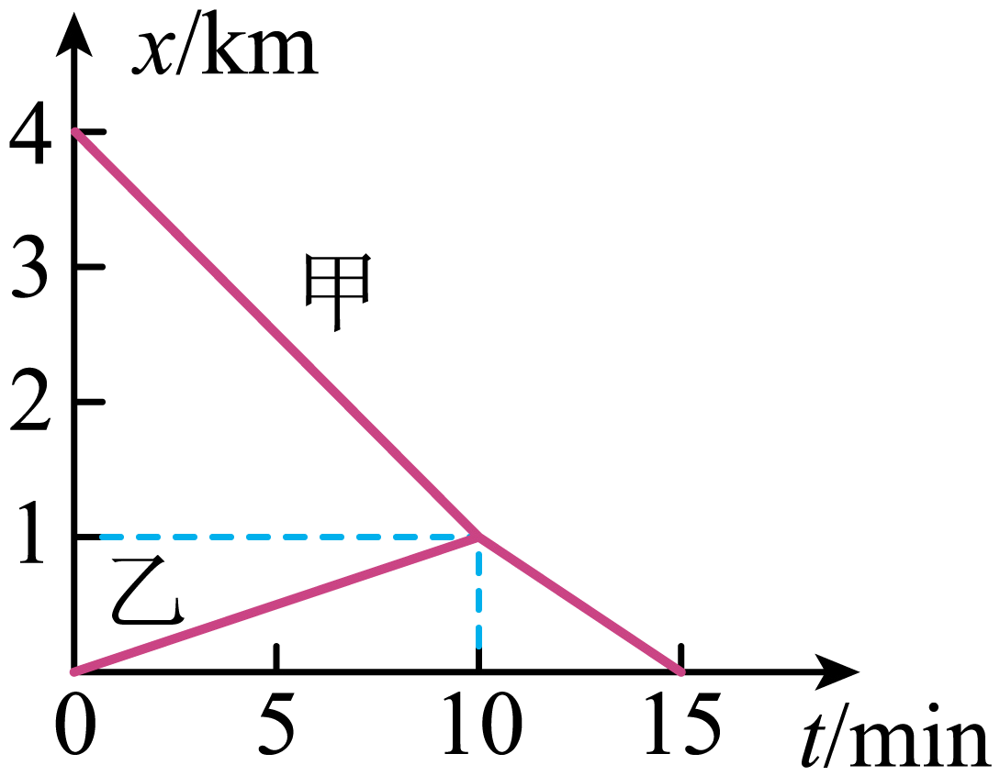

# Physics - 题目 854

**ID**: 86e90b403cc049719e89ac2dee43231b
**年级**: Grade 8
**难度**: Medium
**题型**: Multiple-choice

## 题目
甲同学骑自行车去看望乙同学，得知消息后，乙同学步行去迎接，接到后两人同车返回，整个过程他们的位置与时间的关系如图所示，据图可知（      ）​​​​​​​‌

## 解答

1. 由图像可知，横轴表示时间，纵轴表示路程，在10min时两同学到达同一位置，他们相遇，故A不符合题意；由图像可知，甲同学10min经过的路程为3km，相遇前甲的速度 $v{{}_{甲}}=\frac {s{{}_{甲}}}{t}=\frac {{{3}}{\rm{k}}{\rm{m}}}{{{1}}{{0}}{\rm{m}}{\rm{i}}{\rm{n}}}{\rm{=}}{{0}}{{.}}{{3}}{\rm{k}}{\rm{m}}{\rm{/}}{\rm{m}}{\rm{i}}{\rm{n}}$ ，乙同学10min经过的路程为1km，相遇前乙的速度 $v{{}_{乙}}=\frac {s{{}_{乙}}}{t}=\frac {{{1}}{\rm{k}}{\rm{m}}}{{{1}}{{0}}{\rm{m}}{\rm{i}}{\rm{n}}}{\rm{=}}{{0}}{{.}}{{1}}{\rm{k}}{\rm{m}}{\rm{/}}{\rm{m}}{\rm{i}}{\rm{n}}$ ， $v{{}_{甲}}=3v{{}_{乙}}$ ，故B不符合题意；由图像可知，相遇后乙15min-10min=5min，经过的路程为1km，速度 $v{{}_{乙}}\prime =\frac {s{{}_{乙}}^{′}}{t{{}_{乙}}^{′}}=\frac {{{1}}{\rm{k}}{\rm{m}}}{{{5}}{\rm{m}}{\rm{i}}{\rm{n}}}\mathrm{=}{{0}}{{.}}{{2}}{\rm{k}}{\rm{m}}{\rm{/}}{\rm{m}}{\rm{i}}{\rm{n}}$ ， $v{{}_{乙}}^{′}=2v{{}_{乙}}$ ，故C符合题意；由图像可知，整个过程，甲经过的总路程为4km，乙经过的总路程为2km，故D不符合题意。

## 知识点

**中文**:
  - 速度的图像问题
  - 速度的综合计算

**English**:
  - Velocity-Time Graphs
  - Comprehensive Velocity Calculations

---
