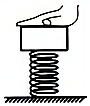

# Physics - 题目 66

**ID**: 9d31d1b1985544358432d9a4d882a432
**年级**: Grade 8
**难度**: Medium
**题型**: Multiple-choice

## 题目
将一木块放在弹簧上用手向下压木块使弹簧被压缩到最低点，如图所示。​​​​​​​‌松开手后，木块在弹力作用下竖直向上运动，在木块到达最高点的过程中(不计空气阻力)。下列说法正确的是（      ）

## 解答

1. A．在最低点时，弹簧的弹性形变最大，弹簧的弹性势能最大，所以弹簧的机械能最大，故A正确；
2. B．在最低点时，若未松手，木块此时静止，处于平衡状态，受平衡力；木块受到竖直向下的重力、手对木块竖直向下的压力、弹簧对木块竖直向上的弹力，此时三力平衡，则有
3. $G{{}_{木}}+F{{}_{压}}=F{{}_{弹}}$
4. 若松手，手对木块无压力，此时木块受力不平衡，弹簧对木块竖直向上的弹力大于木块的重力，即
5. $F{{}_{弹}}>G{{}_{木}}$
6. 故B错误；
7. C．弹簧恢复原状过程中，不计空气阻力，整个系统机械能守恒，弹簧的弹性势能转化为木块的动能和重力势能，木块的机械能增大，故C错误；
8. D．木块上升到最高点时，受到重力作用，合力不为零，不是平衡状态，木块不受平衡力，故D错误。
9. 故选A。

## 知识点

**中文**:
  - 二力平衡的条件及其应用
  - 二力平衡的概念及平衡状态的判断
  - 机械能的变化问题
  - 弹性势能

**English**:
  - Conditions and Applications of Two-Force Equilibrium
  - Concept and Judgment of Equilibrium
  - Changes in Mechanical Energy
  - Elastic Potential Energy

---
