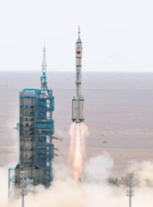

# Physics - 题目 2659

**ID**: a6c3b9568a6d48e5b8adf1302fe1cfcb
**年级**: Grade 8
**难度**: Medium
**题型**: Multiple-choice

## 题目
2022年6月5日，我国运用长征二号火箭，将载有3名航天员的神舟十四号载人飞船送往太空（如图），开始为期6个月的在轨科研工作。​​​​​​​‌飞船在升空的过程中（      ）

## 解答

1. A．火箭在加速升空的过程中，质量不变，速度变大，动能变大，故A符合题意；
2. B．高度增加，重力势能增大，故B不符合题意；
3. C．动能和重力势能都增大，所以机械能增大，故C不符合题意；
4. D．飞船做加速运动，运动状态发生了改变，受力不平衡，故D不符合题意。
5. 故选A。

## 知识点

**中文**:
  - 二力平衡的概念及平衡状态的判断
  - 动能的变化问题
  - 重力势能的变化问题
  - 机械能的变化问题

**English**:
  - Concept and Judgment of Equilibrium
  - Changes in Kinetic Energy
  - Changes in Gravitational Potential Energy
  - Changes in Mechanical Energy

---
