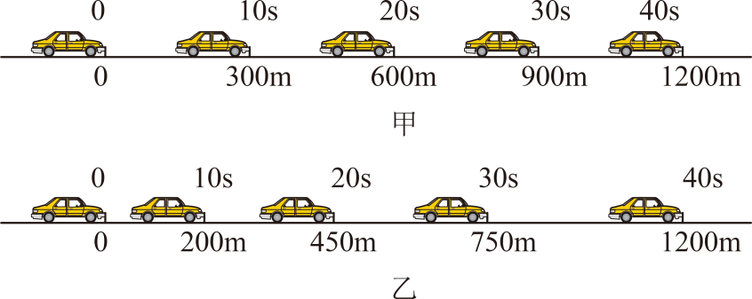

# Physics - 题目 2907

**ID**: a7addc96e22649d6a39c7ddea25ab9fa
**年级**: Grade 8
**难度**: Medium
**题型**: Multiple-choice

## 题目
甲、乙两辆汽车在平直公路上行驶，下图记录了它们在某段时间内的运动过程。​​​​​​​‌关于甲、乙两车的运动情况，下列说法都正确的一组是（      ）①前10s内甲车运动的路程大于乙车运动的路程②甲车达到600m处所用时间小于乙车到达此处所用时间③乙车在做匀速直线运动④甲、乙两辆车在这40s内的平均速度相同

## 解答

1. ①前10s内甲车运动的路程为300m，乙车路程为200m，甲车运动的路程大于乙车运动的路程。故①正确；
2. ②甲车达到600m处所用时间为20s，乙车用20s的时间到达450m，故甲车达到600m处所用时间小于乙车到达此处所用时间，故②正确；
3. ③乙车在相同时间间隔内所通过的路程不同，故乙车没有做匀速直线运动，故③错误；
4. ④甲、乙两辆车在这40s内的路程都为1200m，由 $v=\frac {s}{t}$ 知道，平均速度相同，故④正确。
5. 故D符合题意，ABC不符合题意。

## 知识点

**中文**:
  - 匀速直线运动
  - 长度和时间的测量
  - 平均速度及其计算

**English**:
  - Uniform Linear Motion
  - Measurement of Length and Time
  - Average Velocity and Calculation

---
