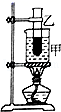

# Physics - 题目 156

**ID**: aa786529416d4578810433829fdec0af
**年级**: Grade 8
**难度**: Medium
**题型**: Multiple-choice

## 题目
如图所示，烧杯中盛有甲液体，试管内盛有乙液体．在l标准大气压下，用酒精灯对烧杯底部持续加热，一段时间后，发现试管内的乙液体沸腾．已知l标准大气压下，酒精沸点是78℃，水沸点是100℃，煤油沸点是150℃，下列判断中符合题意的是（      ）​​​​​​​‌

## 解答

1. A．由三种物质的沸点关系可知：如果甲液体为水，乙液体为水，则试管内的液体不会沸腾，故A错；
2. B．如果甲液体为煤油，乙液体为煤油，则试管内的液体不会沸腾，故B错；
3. C．如果甲液体为酒精，乙液体为水，则试管内的液体不会沸腾，故C错；
4. D．如果甲液体为煤油，乙液体为水，是试管中的液体能够沸腾，符合题意，故D正确．

## 知识点

**中文**:
  - 沸腾及沸腾条件

**English**:
  - Boiling and Boiling Conditions

---
