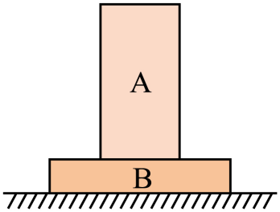

# Physics - 题目 1625

**ID**: b3cfa00f4c75409daf26ba342b412920
**年级**: Grade 8
**难度**: Medium
**题型**: Multiple-choice

## 题目
用同种材料制成的圆柱体A和B，A放在B的正中央，B放在水平地面上，如图所示。​​​​​​​‌若圆柱体A、B的高度之比是 $4\mathrm{∶}1$ ，且A对B的压强和B对地面的压强相等，则A的底面积与B的底面积之比是（      ）

## 解答

1. 设圆柱体A和B的底面积分别为 $S{{}_{{\rm{A}}}}$ 、 $S{{}_{{\rm{B}}}}$ ，高度分别为 $h{{}_{{\rm{A}}}}$ 、 $h{{}_{{\rm{B}}}}$ ，密度均为 $ρ$ ，则A的重力为 $G{{}_{{\rm{A}}}}=m{{}_{{\rm{A}}}}g=ρV{{}_{{\rm{A}}}}g=ρS{{}_{{\rm{A}}}}h{{}_{{\rm{A}}}}g{\rm ，B}$ 的重力为 $G{{}_{{\rm{B}}}}=m{{}_{{\rm{B}}}}g=ρV{{}_{{\rm{B}}}}g=ρS{{}_{{\rm{B}}}}h{{}_{{\rm{B}}}}g{\rm ，A}$ 对B的压强和B对地面的压强相等，根据 $p=\frac {F}{S}$ 则有， $\frac {ρS{{}_{{\rm{A}}}}h{{}_{{\rm{A}}}}g}{S{{}_{{\rm{A}}}}}=\frac {ρS{{}_{{\rm{A}}}}h{{}_{{\rm{A}}}}g+ρS{{}_{{\rm{B}}}}h{{}_{{\rm{B}}}}g}{S{{}_{{\rm{B}}}}}$    ①，又因为
2. $\frac {h{{}_{{\rm{A}}}}}{h{{}_{{\rm{B}}}}}=\frac {4}{1}$    ②，联立①②，解得 $\frac {S{{}_{{\rm{A}}}}}{S{{}_{{\rm{B}}}}}=\frac {3}{4}$ 。故ABC不符合题意，D符合题意。

## 知识点

**中文**:
  - 固体压强的判断与计算

**English**:
  - Determination and Calculation of Solid Pressure

---
