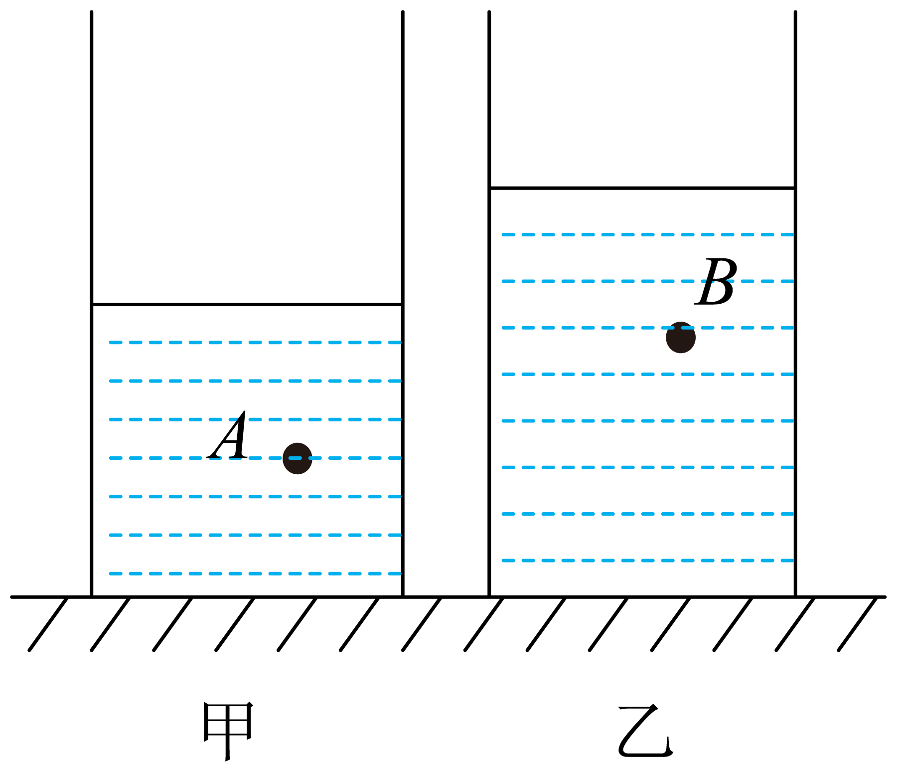

# Physics - 题目 409

**ID**: b4d76abd5222459d93849ffc9d4b8eac
**年级**: Grade 8
**难度**: Medium
**题型**: Multiple-choice

## 题目
如图所示，在两个完全相同的容器中，盛有质量相等的水和酒精（密度ρ_{酒精}<ρ_{水}），下列说法正确的是（      ）​​​​​​​‌

## 解答

1. A．根据 $ρ{\rm{=}}\frac {m}{V}$ 得，物体的体积
2. $V{\rm{=}}\frac {m}{ρ}$
3. 当质量相等时，物体的密度越大，体积越小；水的密度大于酒精的密度，液体的体积小为水，故A错误；
4. B．根据液体压强公式 $p=ρ{{}_{液}}gh$ 得，密度越大，深度越深压强越大，故B错误；
5. C．甲容器和乙容器底部受到的压力大小都等于液体的重力大小，水和酒精的质量相同的，所受重力相同，所以甲容器和乙容器底部受到的压力大小相等，故C错误；
6. D．甲、乙两容器底部受到的压力相同，相同的容器受力面积相同，根据 $p=\frac {F}{S}$ 得，压强相等，故D正确。
7. 故选D。

## 知识点

**中文**:
  - 压力大小的比较
  - 密度公式的应用
  - 压强大小的比较
  - 液体压强计算公式的应用

**English**:
  - Comparing Magnitude of Pressure Force
  - Application of Density Formula
  - Comparing Pressure
  - Application of Liquid Pressure Formula

---
