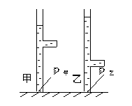

# Physics - 题目 824

**ID**: bbd91cac77ce4dbf907a9fa1e71ba8df
**年级**: Grade 8
**难度**: Medium
**题型**: Multiple-choice

## 题目
如图，开口向上的两个“凸”形管竖立在水平桌面上的，除了凸部分在竖直管上的位置有高低之外，其余完全相同．现将甲管装盐水，乙管装等质量的蒸馏水，两管液面都超出各自的凸出部位，且液体都已将各管的凸出部分充满．则两管底部受到液体压强之间的关系是​​​​​​​‌

## 解答

1. 由于液体压强只与密度和深度有关，假设将图中容器凸出部分割掉，使两容器都变成一个规则的细圆柱形，液体对容器底的压强大小不变．
2. 凸出部分完全相同，即体积相同，盐水的密度大，根据 $m=ρV$ 知，割去部分液体质量 $m{{}_{盐}}^{′}>m{{}_{水}}^{′}$ ，原来质量相等，所以有： $m{{}_{盐}}-m{{}_{盐}}^{′}<m{{}_{水}}-m{{}_{水}}^{′}$ ，即割掉这部分后，剩余部分盐水质量小，蒸馏水质量大；
3. 根据 $p=\frac {F}{S}=\frac {G}{S}=\frac {mg}{S}$ 可得： $ P{{}_{甲}}<{\rm{ }}P{{}_{乙}}$ ．
4. 故选B．

## 知识点

**中文**:
  - 压强大小的比较
  - 液体压强的特点及应用

**English**:
  - Comparing Pressure
  - Characteristics and Applications of Liquid Pressure

---
