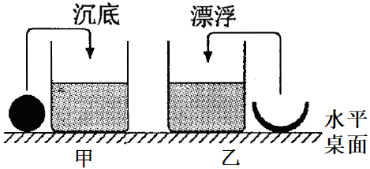

# Physics - 题目 1298

**ID**: df978f9f3a5b4067847270a130ba9490
**年级**: Grade 8
**难度**: Medium
**题型**: Multiple-choice

## 题目
如图所示，将两块相同的橡皮泥做成实心球形和碗形，分别放入相同的甲、乙两杯水中（若杯中水均没有溢出）。​​​​​​​‌静止时，甲杯中，球形橡皮泥沉底，水面上升高度为h_{1}，放入橡皮泥后容器底部受到水的压强为p_{1}，球形橡皮泥受到水的浮力为F_{1}，杯子对桌面的压力为F_{甲}；乙杯中，碗形橡皮泥漂浮，水面上升高度为h_{2}，放入橡皮泥后容器底部受到水的压强为p_{2}，碗状橡皮泥受到的浮力为F_{2}，杯子对桌面的压力F_{乙}。下列比较不正确的是（      ）

## 解答

1. 两橡皮泥相同，球形橡皮泥沉底，碗形橡皮泥漂浮，所以 $F{{}_{1}}\langle F{{}_{2}}$ ，由 $F{{}_{浮}}=ρ{{}_{液}}V{{}_{排}}g$ 得，碗形橡皮泥排开水的体积 $V{{}_{乙}}$ 大于球形橡皮泥排开水的体积 $V{{}_{甲}}$ ，所以由 $V=Sh$ 得，S相同时， $h{{}_{1}}\langle h{{}_{2}}$ ，所以乙杯水的总高度大于甲杯水的总高度，由 $p=ρgh$ 得 $p{{}_{1}}\langle p{{}_{2}}$ 。在水平桌面上， $F{{}_{压}}=G$ ，甲乙两杯水放入橡皮泥后，G相等，所以 $F{{}_{甲}}={\rm{\;}}F{{}_{乙}}$ 。本题选择的是不正确的，因此ABD正确，都不符合题意；C不正确，符合题意。
2. 故选C。

## 知识点

**中文**:
  - 液体压强计算公式的应用
  - 阿基米德原理的应用

**English**:
  - Application of Liquid Pressure Formula
  - Applications of Archimedes' Principle

---
