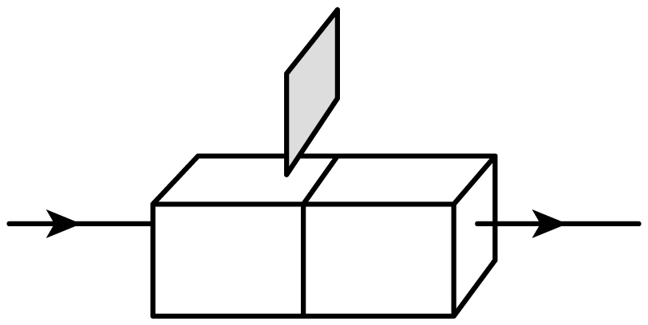

# Physics - 题目 2900

**ID**: f5165fe776df428db1e801ce36eff41d
**年级**: Grade 8
**难度**: Medium
**题型**: Multiple-choice

## 题目
如图所示是一个魔术箱，魔术箱的顶部的中央有一条窄缝，使激光笔产生的激光束从左侧的小孔射入，从右侧小孔射出．将一块遮光板从顶部的窄缝插入箱中，发现遮光板并没有挡住激光束的传播．下面几种设计方案中错误的是​​​​​​​‌

## 解答

1. A、如图，激光经过三个镜面的反射，绕过中间的挡板，设计方案正确；
2. B、如图，左侧的凸透镜，与主光轴平行的光线折射后过焦点，再经过下面镜面的反射，经过右侧凸透镜的焦点，折射后平行于主光轴射出，设计方案正确；
3. C、如图，左侧的凹透镜，与主光轴平行的光线折射后反射延长线应过焦点，图中光线传播方向不正确，设计方案不正确，符合题意；
4. D、如图，左侧的凹透镜，与主光轴平行的光线折射后反射延长线过焦点，再经过下面镜面的反射，延长线过右侧凹透镜的焦点，折射后平行于主光轴射出，设计方案正确．
5. 故选C．

## 知识点

**中文**:
  - 凸透镜的会聚作用
  - 镜面反射和漫反射
  - 凹透镜的发散作用

**English**:
  - Converging Effect of Convex Lenses
  - Specular and Diffuse Reflection
  - Diverging Effect of Concave Lenses

---
