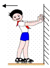

# Physics - 题目 1169

**ID**: f636d48b8148422d90f1543efd2b7d00
**年级**: Grade 8
**难度**: Medium
**题型**: Multiple-choice

## 题目
如图所示，当人推墙时，人将向后退，对此现象的一些说法中正确的是：（      ）​​​​​​​‌

## 解答

1. A．力不能离开物体而存在，当人推墙时，人将向后退，人离开墙后不再受到墙的作用力，故A错误．
2. B．人离开墙后，由于人具有惯性，要保持原来的运动状态，能后退一段距离，故B正确，符合题意为答案．
3. C．惯性是一切物体固有的属性，人停下来后仍具有惯性，故C错误．
4. D．人对墙的力与墙对人的力作用在两个物体上，是相互作用力，不是一对平衡力，故D错误．

## 知识点

**中文**:
  - 平衡力与相互作用力的区别
  - 惯性的概念

**English**:
  - Difference between Equilibrium Forces and Interaction Forces
  - Concept of Inertia

---
