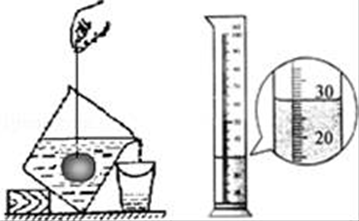

# Physics - 题目 1155

**ID**: f6b4e352c799437f82f473aba6b79307
**年级**: Grade 8
**难度**: Medium
**题型**: Multiple-choice

## 题目
丹丹想知道一个质量为79g的铁球是空心还是实心的，因铁球放不进量筒而做了如下探究：把铁球放入装满水的烧杯，收集溢出的水，然后把溢出的水全部倒入量筒中，测出溢出水的体积如图所示．请你帮丹丹同学判断铁球是空心还是实心？若是空心，空心部分的体积是多少？（      ）ρ_{铁}=7.​​​​​​​‌9×10^{3}kg/m^{3}．

## 解答

1. 由题，铁球浸没在水中，则V_{球}=V_{溢}=30cm^{3}，
2. 根据 ${\rm{ρ}}=\frac {m}{V}$ 可得，
3. 铁球中铁的体积 $V{{}_{铁}}=\frac {m{{}_{球}}}{ρ{{}_{铁}}}=\frac {79\times 10{^{-3}}kg}{7.9\times 10{^{3}}kg/m{^{3}}}=1\times 10{^{-5}}m{^{3}}=10cm{^{3}}<V{{}_{球}}$ ，
4. 所以铁球是空心的．
5. 空心的体积V_{空}=V_{球}-V_{铁}=30cm^{3}-10cm^{3}=20cm^{3}．
6. 故答案为B．
7. 【点睛】
8. 本题考查密度知识的应用，可以通过体积、密度或质量三种方法判断铁球是实心的还是空心的，因为要计算空心体积，最好根据体积进行判断．

## 知识点

**中文**:
  - 空心、混合物质的密度计算

**English**:
  - Density Calculation of Hollow/Mixed Substances

---
