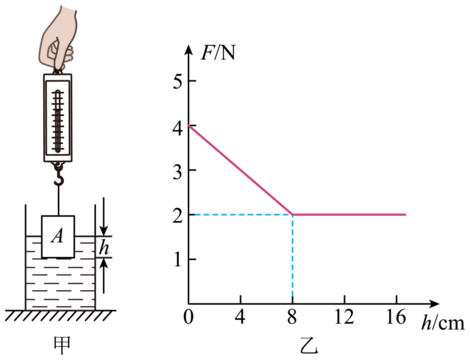

# Physics - 题目 1750

**ID**: ffd4f1fa2ba949ec824bf0587c57169c
**年级**: Grade 8
**难度**: Medium
**题型**: Multiple-choice

## 题目
小华用如图甲所示进行实验“探究影响浮力大小的因素”，A是实心圆柱体，用弹簧测力计悬挂A缓慢浸入水中、他根据数据作出的弹簧测力计示数F与物体下表面浸入水中的深度h的关系图像如图乙，下列说法错误的是（      ）​​​​​​​‌

## 解答

1. A．由图示图像可知，物体没有浸入液体时测力计示数为4N，则物体重力为 $G=4{\rm{N}}$ ，物体完全浸没在水中时受到的浮力为
2. $F{{}_{浮}}=G-F=4{\rm{N}}-2{\rm{N}}=2{\rm{N}}$
3. 故A正确，不符合题意；
4. B．由图示图像可知，圆柱体A从接触水面到完全浸没的高度为8cm，即圆柱体A的高为8cm，故B正确，不符合题意；
5. C．完全浸没时，物体的体积和排开水的体积相同，由 $F{{}_{浮}}=ρ{{}_{液}}gV{{}_{排}}$ 可知，物体的体积为
6. $V=V{{}_{排}}=\frac {F{{}_{浮}}}{ρ{{}_{水}}g}=\frac {2{\rm{N}}}{1\times 10{^{3}}{\rm{k}}{\rm{g}}{\rm{/}}{\rm{m}}{^{3}}\times 10{\rm{N}}{\rm{/}}{\rm{k}}{\rm{g}}}=2\times 10{^{-4}}{\rm{m}}{^{3}}$
7. 由 $G=mg$ 可知，物体的质量为
8. $m=\frac {G}{g}=\frac {{\rm{4}}{\rm{N}}}{{\rm{1}}{\rm{0}}{\rm{N}}{\rm{/}}{\rm{k}}{\rm{g}}}=0.4{\rm{k}}{\rm{g}}$
9. 物体的密度为
10. $ρ{{}_{物}}=\frac {m}{V}=\frac {0.4{\rm{k}}{\rm{g}}}{2\times 10{^{-4}}{\rm{m}}{^{3}}}=2\times 10{^{3}}{\rm{k}}{\rm{g}}{\rm{/}}{\rm{m}}{^{3}}$
11. 故C错误，符合题意；
12. D．由图示图像可知，物体没有完全浸没在液体中前受到的浮力与物体浸入液体的深度成正比，物体完全浸入液体后受到的浮力不变，故D正确，不符合题意。
13. 故选C。

## 知识点

**中文**:
  - 浮力大小的计算
  - 阿基米德原理的应用

**English**:
  - Calculation of Buoyancy
  - Applications of Archimedes' Principle

---
