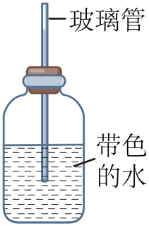

# Physics - 题目 2436

**ID**: 64c3a922adc5421aa6613888528de243
**年级**: Grade 8
**难度**: Medium
**题型**: Multiple-select

## 题目
取一个瓶子，装入适量带色的水，再取一根两端开口的细玻璃管，在它上面画上刻度，使玻璃管穿过密封的橡皮塞插入水中并使玻璃管内水面上升到瓶口以上。​​​​​​​‌下列做法中，可以使细玻璃管内水柱高度增加的是（      ）

## 解答

1. A．将瓶子从山顶拿到山脚，海拔高度降低，大气压变增大，瓶内气压不变，瓶内外气压差变小，玻璃管内水柱高度降低，故A不符合题意；
2. B．将瓶子从山脚拿到山顶，海拔高度升高，大气压变小，瓶内气压不变，瓶内外气压差变大，玻璃管内水柱高度增大，故B符合题意；
3. C．用嘴从玻璃管口处用力吸气，瓶内气压减小，外界大气压不变，瓶内外气压差变小，松口后玻璃管内水柱高度降低，故C不符合题意；
4. D．用吹风机在玻璃管口处沿水平方向吹风，玻璃管口处流体流速变大压强变小，瓶内气压不变，瓶内外气压差变大，玻璃管内水柱高度增大，故D符合题意。
5. 故选BD。

## 知识点

**中文**:
  - 大气压强与高度的关系
  - 大气压的应用
  - 流体压强与流速的关系

**English**:
  - Relationship between Atmospheric Pressure and Altitude
  - Applications of Atmospheric Pressure
  - Relationship between Fluid Pressure and Flow Speed

---
