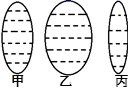

# Physics - 题目 1265

**ID**: a553d65d6edf4403b070cac55637d7b4
**年级**: Grade 8
**难度**: Medium
**题型**: Multiple-select

## 题目
如图所示，小海用薄膜充水后制成水透镜模拟眼球中的晶状体，来比较正常眼、近视眼、远视眼的视物差别。​​​​​​​‌实验中假定图甲中的透镜为正常眼晶状体的形状，并测得其焦距为10cm，再将甲分别挤压成图乙、丙的形状。如图所示，能够模拟远视眼的成因及矫正方法的是

## 解答

1. 因凸透镜的凸度越大，焦距越小，所以实验中测得甲图焦距为10cm，再将甲分别挤压成乙图、丙图的形状，由图可以看出，乙图的凸度比丙图大，则焦距小于10cm的是图乙，大于10cm的是图丙；因为丙的焦距比乙的焦距大，所以会聚能力减弱，因此B模拟的是远视眼，A模拟的是近视眼；远视眼应佩戴凸透镜进行矫正；综上所述，故选BD。

## 知识点

**中文**:
  - 近视眼的成因与矫正办法
  - 远视眼的成因与矫正办法

**English**:
  - Causes and Correction of Myopia (Nearsightedness)
  - Causes and Correction of Hyperopia (Farsightedness)

---
