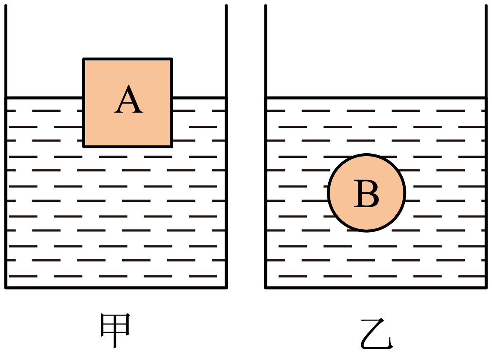

# Physics - 题目 828

**ID**: b3c2a65a33114c4da3494c73f45a4a55
**年级**: Grade 8
**难度**: Medium
**题型**: Multiple-select

## 题目
甲、乙两个相同的玻璃杯中装有体积相等的两种液体，静止放置在水平桌面上，将同种材料制作的实心物体A、B分别放入两玻璃杯中，静止时两液面等高，如图所示。​​​​​​​‌下列说法正确的是（      ）

## 解答

1. A．由图可知，甲中A漂浮，则A的密度小于甲杯中液体的密度，乙中B悬浮，则B的密度等于乙杯中液体的密度，A、B材质相同，密度相同，则甲杯中液体的密度大于乙杯中液体的密度，故A正确；
2. B．甲杯中液体的密度大于乙杯中液体的密度，两液面等高，根据 $p=ρgh$ 可知甲杯底部受到液体的压强大于乙杯底部受到液体的压强，故B错误；
3. C．甲、乙两个相同的玻璃杯中装有体积相等的两种液体，将同种材料制作的实心物体A、B分别放入两玻璃杯中后，静止时两液面等高，则A、B排开液体的体积相同，甲杯中液体的密度大于乙杯中液体的密度，根据 $F{{}_{浮}}=ρ{{}_{液}}gV{{}_{排}}$ 可知A 受到的浮力大于B受到的浮力，故C正确；
4. D．根据阿基米德原理，A受到的浮力等于A排开液体的重力，故D错误。

## 知识点

**中文**:
  - 密度、压强和浮力的综合

**English**:
  - Integrated Density, Pressure, and Buoyancy

---
