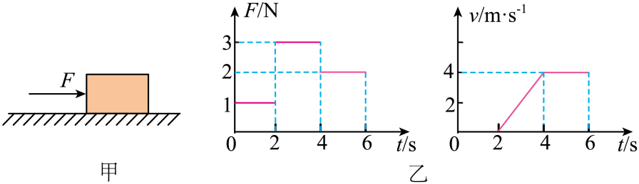

# Physics - 题目 1103

**ID**: d511197e354d4f55985467fb9318c8f2
**年级**: Grade 8
**难度**: Medium
**题型**: Multiple-select

## 题目
如图甲所示，水平地面上的一物体，受到方向不变的水平推力F的作用，F的大小与时间t的关系和物体的速度v与时间t的关系如图乙所示，以下说法正确的是（      ）​​​​​​​‌

## 解答

1. A．由v-t图像可知，0~2s内物体的速度为0，即静止，处于平衡状态，受到的摩擦力和推力是一对平衡力，二力大小相等，故A错误；
2. B．由v-t图像可知，2~4s内物体运动的速度均匀增大，做的不是匀速直线运动，是变速直线运动，故B错误；
3. CD．由v-t图像可知，4~6s内物体运动的速度为4 m/s不变，即做匀速直线运动，处于平衡状态，受到的滑动摩擦力和推力是一对平衡力；由F-t图像可知，4~6s内推力的大小为2 N，则物体受到的滑动摩擦力为2N；因滑动摩擦力只与压力的大小和接触面的粗糙程度有关，与物体运动的速度无关，所以2~4s内物体受到的摩擦力是2N，故CD正确。
4. 故选CD。

## 知识点

**中文**:
  - 二力平衡的概念及平衡状态的判断
  - 滑动摩擦力大小的影响因素

**English**:
  - Concept and Judgment of Equilibrium
  - Factors Affecting Sliding Friction

---
