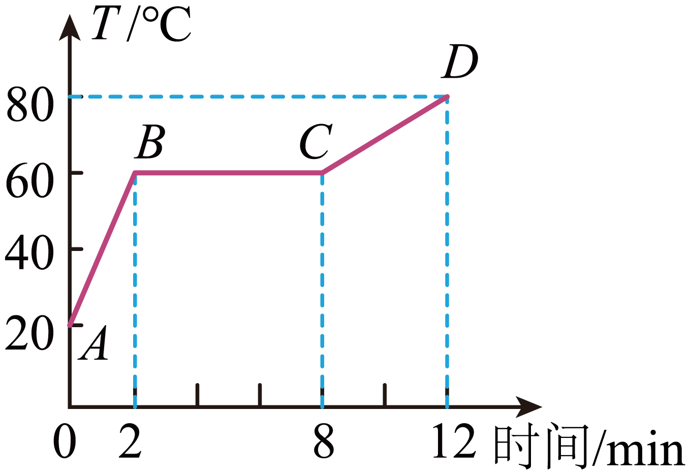

# Physics - 题目 291

**ID**: d8b5ddeff9fb4989bcd78ede80cb34f0
**年级**: Grade 8
**难度**: Medium
**题型**: Multiple-select

## 题目
给某物体均匀加热，设该物体熔化时吸收的热量与加热时间成正比，得到其温度随时间变化的关系如图所示，下列说法中正确的是（      ）​​​​​​​‌

## 解答

1. AB．图中为某物质的熔化图像，熔化吸热。由图可知，物质在2~8min内即BC时段吸收热量但温度保持不变，因此该物质是晶体，它的熔点为60℃，故AB正确；
2. CD．由图可知，物质在AB时段为固态，在CD时段为液态，物质的质量保持不变，物质在固态与液态时加热时间之比为1∶2，则吸收的热量之比为1∶2，温度升高之比为2∶1，故该物体在固态时的比热容与液态时的比热容之比是 $\frac {c{{}_{固}}}{c{{}_{液}}}=\frac {\frac {Q{{}_{固}}}{m{\rm{Δ}}t{{}_{固}}}}{\frac {Q{{}_{液}}}{m{\rm{Δ}}t{{}_{液}}}}=\frac {Q{{}_{固}}m{\rm{Δ}}t{{}_{液}}}{Q{{}_{液}}m{\rm{Δ}}t{{}_{固}}}=\frac {Q{{}_{固}}{\rm{Δ}}t{{}_{液}}}{Q{{}_{液}}{\rm{Δ}}t{{}_{固}}}=\frac {1\times 1}{2\times 2}=\frac {1}{4}$ ，故C错误，D正确。

## 知识点

**中文**:
  - 晶体和非晶体的区别
  - 熔点和凝固点
  - 熔化的温度—时间图像
  - 比热容的概念及其计算

**English**:
  - Difference between Crystals and Amorphous Solids
  - Melting Point and Freezing Point
  - Temperature-Time Graph of Melting
  - Concept and Calculation of Specific Heat Capacity

---
