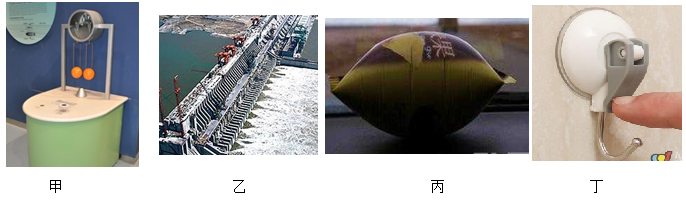

# Physics - 题目 600

**ID**: d938c72724c440ba9ac9b7d61497912e
**年级**: Grade 8
**难度**: Medium
**题型**: Multiple-select

## 题目
关于图所示各种情景，下列说法中正确的是（      ）​​​​​​​‌

## 解答

1. A. “球吸现象”中，两球向中间空气流速大，压强小，而两球外侧空气流速小，压强大，所以两球的内外产生压强差使两球靠拢，故A错误。
2. B. 船闸的上游与闸室、闸室与下游是各构成连通器，是利用连通器原理工作的，故B正确。
3. C. 北京是低海拔地区，气压高，对食物包装的压力大，所以不会鼓；而高原地区因为海拔高，气压低，食物包装内的气压大于外界大气压，所以变鼓了，故C正确。
4. D. 吸盘式挂钩在安装时，要用力按压将盘内空气挤出，松手后空气不能流回盘内，所以盘内气压就小于外界大气压，即大气压将吸盘压住，从而增大吸盘与墙壁的摩擦力使得吸盘不会掉下，利用了大气压，故D正确。

## 知识点

**中文**:
  - 大气压强与高度的关系
  - 连通器原理
  - 大气压强的测量及标准大气压
  - 流体压强与流速的关系

**English**:
  - Relationship between Atmospheric Pressure and Altitude
  - Principle of Communicating Vessels
  - Measurement of Atmospheric Pressure & Standard ATM
  - Relationship between Fluid Pressure and Flow Speed

---
