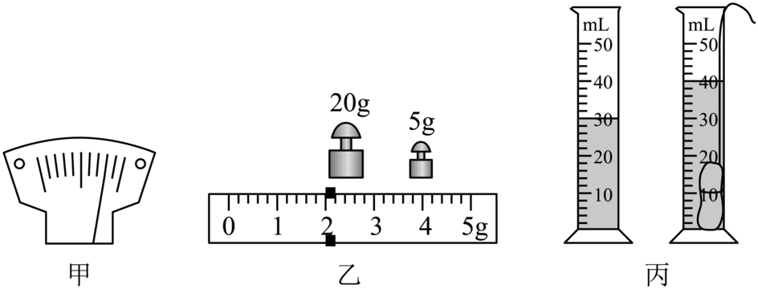

# Physics - 题目 1301

**ID**: de39448ec13548609116705e35526849
**年级**: Grade 8
**难度**: Medium
**题型**: Multiple-select

## 题目
如图所示，是某学习小组在做“测量石块的密度”时的部分场景。​​​​​​​‌下列说法正确的是（      ）

## 解答

1. A．图甲中指针偏右，说明右侧偏重，应向左调节平衡螺母使天平平衡，故A错误；
2. B．读数时应以游码左端边缘所对的刻度值为准，石块的质量为
3. m=20g+5g+2g=27g
4. 故B错误；
5. C．石块的体积为
6. V=V_{2}-V_{1}=40cm^{3}-30cm^{3}=10cm^{3}
7. 石块的密度为
8. $ρ=\frac {m}{V}=\frac {27{\rm{g}}}{10cm{^{3}}}=2.7{\rm{g}}/cm{^{3}}$
9. 故C正确；
10. D．将石块放入量筒中时发现石块表面有气泡，则测得的V_{2}体积偏大，会导致密度的测量值偏小，故D正确。

## 知识点

**中文**:
  - 固体密度的测量实验

**English**:
  - Experiment: Measuring Density of Solids

---
