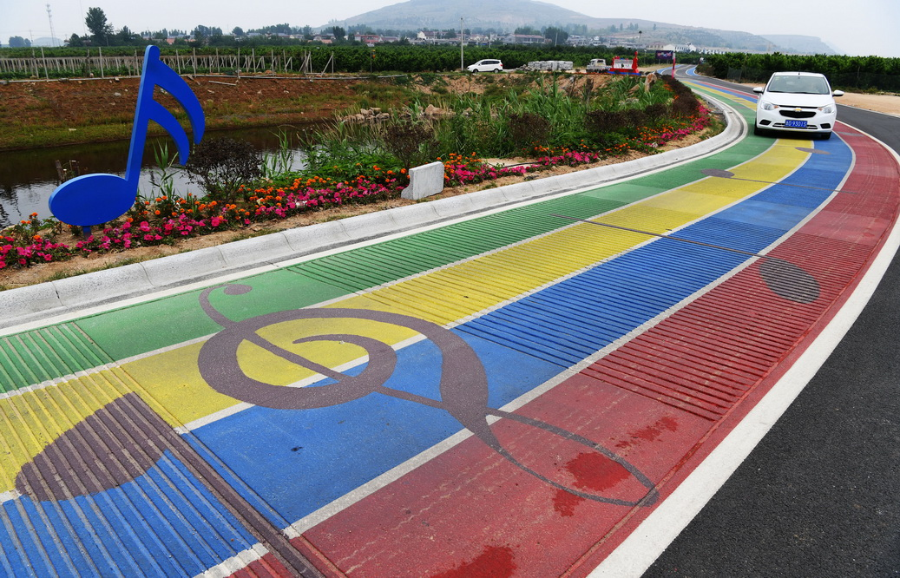

# Physics - 题目 784

**ID**: 165f84eb165f4d52bf09ce7e01036ae6
**年级**: Grade 8
**难度**: Medium
**题型**: Science Reading

## 题目
音乐公路我国有些地方修筑了“音乐公路”。​​​​​​​‌当汽车以一定速度匀速行驶时，就会奏出一段乐曲。音乐公路的路面上分布着许多横向凹槽，如图所示。汽车每经过一个凹槽，就会上下振动一次。凹槽是根据不同乐曲的曲调设计切割的，不间的槽宽、槽间距和槽深象征着不同的音符，轮胎与地面的接触声音、与空气的撞击声音就汇合成高低不同、节奏有致的音乐和旋律，有凹槽的公路好比是“唱片”，汽车轮胎是“唱针”，两者组合在一起，犹如留声机一样。（1）汽车行驶时奏出的一段乐曲是由于物体的产生的，是通过传入人耳的，这种声音（填“一定”或“不一定”）是乐音。（2）凹槽的疏密可以根据乐曲的音调高低来设计，假设某音乐公路规定的行驶速度是54km/h，设定乐曲为《歌唱祖国），第一个音符“sol”的频率为392Hz，即1s内振动次。汽车发出这个音时，所对应的相邻凹槽之间的距离是cm（保留一位小数）。（3）若汽车速度大于54km/h，则听到音乐的（填“响度”“音调”或“音色”）发生了明显变化。

## 解答

1. （1）我们听到的“音乐公路”发出来的声音主要是通过疏密不同的横向凹槽振动产生的。
2. 声音可以在固体、液体、气体中传播，由题意可知，声音是通过空气传入人耳的。
3. 从物理学的角度来说，噪声是发声体做无规则振动时发出的声音。从环境保护的角度来说，凡是妨碍人们正常休息、学习和工作的声音，以及对人们要听的声音产生干扰的声音，都属于噪声，故这种声音不一定是乐音。
4. （2）物理学中，振动快慢用每秒振动的次数来表示，称为频率，音符“sol”的频率为392Hz，即1s内振动392次。
5. 汽车的行驶速度是 $v=54{\rm{k}}{\rm{m}}{\rm{/}}{\rm{h}}=15{\rm{m}}{\rm{/}}{\rm{s}}$
6. 即每秒通过的路程是15m。汽车每经过一个凹槽就会上下振动一次，因此汽车发出“sol”这个音符时，所对应的相邻凹槽之间的距离为 $s=\frac {{{1}}{{5}}{\rm{m}}}{{{3}}{{9}}{{2}}}\approx 0.038{\rm{m}}{\rm{=}}{{3}}{{.}}{{8}}{\rm{c}}{\rm{m}}$
7. （3）当车辆以54km/h左右的速度行驶变成大于54km/h行驶时，轮胎振动的频率发生变化，故听到音乐的音调也会发生变化。

## 知识点

**中文**:
  - 声音的产生和声源
  - 速度公式及其应用
  - 声音的传播途径

**English**:
  - Sound Production and Sound Sources
  - Velocity Formula and Applications
  - Pathways of Sound Propagation

---
