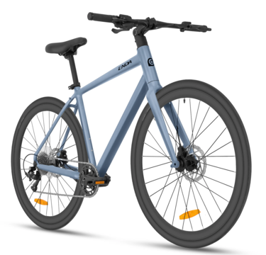

# Physics - 题目 2419

**ID**: dbbc4c0da7f8428cbb6b16edbd63b5e8
**年级**: Grade 8
**难度**: Medium
**题型**: Science Reading

## 题目
阅读短文，回答问题为了响应“低碳生活，绿色出行”倡议，越来越多的人选择自行车（如图）作为交通出行方式。​​​​​​​‌自行车中涉及到很多的物理知识，尤其是摩擦力。例如：自行车的驱动靠的是轮胎与地面接触产生的静摩擦力，当人踩踏板驱动后轮转动时，轮胎试图向后“推”地面，此时地面就给轮胎一个向前的摩擦力，这是自行车前进的根本动力。如果摩擦力太小，轮胎就会打滑，车子难以前进。（1）自行车的轮胎常由橡胶制成，是由于橡胶具有较好的（      ）；

## 解答

1. （1）橡胶具有良好的弹性，可以起到减震的效果。其他几个选项与轮胎材料的选择无关，故B符合题意，A、C、D不符合题意。
2. （2）后轮所受静摩擦力驱动自行车向前运动，提供动力，所以该静摩擦力属于有益摩擦力。
3. 轮胎上设计成花纹样式，可以增大接触面的粗糙程度。所以轮胎上的花纹是在压力一定时，通过增大接触面粗糙程度来增大摩擦力。
4. （3）轮胎试图向后“推”地面，给地面一个向后的作用力，由于力的作用是相互的，同时地面就给轮胎一个向前的摩擦力。
5. （4）在压力一定时，可以增大受力面积来减小压强，坐起来会更舒服，所以可以换用宽大的坐垫。
6. （5）当质量一定时，骑行速度越大，动能越大，骑行的危险性就越大，所以严禁超速。

## 知识点

**中文**:
  - 力的作用是相互的
  - 物质的物理属性
  - 摩擦力及其产生条件
  - 增大或减小摩擦的方法
  - 增大及减小压强的方法与应用
  - 动能的影响因素

**English**:
  - Interaction of Forces
  - Physical Properties of Matter
  - Friction and Conditions for Generation
  - Methods to Increase or Decrease Friction
  - Methods and Applications of Increasing/Decreasing Pressure
  - Factors Affecting Kinetic Energy

---
