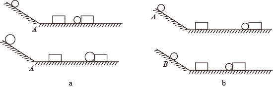

# Physics - 题目 2042

**ID**: 96908a9b7ca3469ea54c80a4ec0c945f
**年级**: Grade 8
**难度**: Medium
**题型**: Short Answer

## 题目
近年来，交通部门加大了打击汽车超载超速的力度，这是为了交通安全和延长公路的使用年限。​​​​​​​‌下面两小题是关于超载和超速问题的研究。（1）为什么要严禁超载？某课题组利用斜面、小球和木块进行研究。让质量不同的小球分别从同一高度，由静止开始滑下（如图中a所示）。小球经过A点时速度相等。请根据实验想象，用学过的科学知识，解释超载存在的安全隐患；（2）为了解释严禁超速的原因，他们利用小球和斜面进行研究。让同一小球从A、B两点由静止开始滑下（如图中b所示）。情根据实验现象，用学过的科学知识，解释超速存在的安全隐患。

## 解答

1. （1）由a图可知，当物体速度相同时，物体的质量越大，物体具有的动能越大。所以当车辆速度相同时，超载后的动能增大，刹车后由于惯性向前滑行的距离变大，容易引发事故。
2. （2）由b图可知，当物体质量相同时，物体的速度越大，物体具有的动能越大。所以当车辆质量相同时，车的速度越大，动能越大，刹车后由于惯性向前滑行的距离变大，容易引发事故。

## 知识点

**中文**:
  - 动能的影响因素
  - 生活中的惯性现象

**English**:
  - Factors Affecting Kinetic Energy
  - Inertia Phenomena in Daily Life

---
