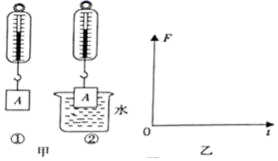

# Physics - 题目 2252

**ID**: f29b90e85bef45d6813a6e9604ff5a29
**年级**: Grade 8
**难度**: Medium
**题型**: Short Answer

## 题目
如图甲图，有一个圆柱体A悬挂在弹簧测力计下，若小东用弹簧测力计悬挂圆柱体渐渐地放入水中直至完全浸没（不接触容器底部），请在图乙中画出弹簧测力计示数F﹣t大致图象．​​​​​​​‌

## 解答

1. 没有浸入水中之前，弹簧测力计测量圆柱体的重力，由于圆柱体的重力不变，则测力计的示数不变；
2. 渐渐地浸入水中直至完全浸没时，由于排开水的体积变大，根据阿基米德原理知道，浮力变大，由F＝G﹣F_{浮}知道，拉力变小，即弹簧测力计的示数变小；
3. 当完全浸没后由于排开水的体积不变，则浮力不变，根据F＝G﹣F_{浮}知道，弹簧测力计的示数不变；
4. 所以F﹣t大致图象如下：
5. ．

## 知识点

**中文**:
  - 浮力大小的计算

**English**:
  - Calculation of Buoyancy

---
