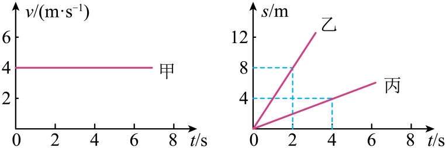

# Physics - 题目 2868

**ID**: 6e2218b0783d4a1a8425c37e921b797e
**年级**: Grade 8
**难度**: Medium
**题型**: 未知

## 题目
甲、乙、丙三辆小车同时、同地向东行驶，它们运动的图像如图所示。​​​​​​​‌由图像可知（      ）

## 解答

1. AB．由v-t图像可知，是一条平行于时间轴的直线，可知甲车做匀速直线运动，速度大小为4m/s；由s-t图像可知，乙车的s-t图像是一条过原点的倾斜直线，可知乙车做匀速直线运动，速度大小为 $v{{}_{乙}}{\rm{=}}\frac {s{{}_{乙}}}{t{{}_{乙}}}{\rm{=}}\frac {{{8}}{\rm{m}}}{{{2}}{\rm{s}}}{\rm{=}}{{4}}{\rm{m}}{\rm{/}}{\rm{s}}$ ，同理可知，丙车也做匀速直线运动，速度大小为 $v{{}_{丙}}{\rm{=}}\frac {s{{}_{丙}}}{t{{}_{丙}}}{\rm{=}}\frac {{{4}}{\rm{m}}}{{{4}}{\rm{s}}}{\rm{=}}{{1}}{\rm{m}}{\rm{/}}{\rm{s}}$ ，所以，甲车和乙车的速度相等，运动一样快；故A不符合题意，B符合题意；
2. C．由于甲、丙两辆小车同时、同地向东行驶，甲车的速度大于丙车的速度，以甲车为参照物，丙车向西运动，故C不符合题意；
3. D．由于乙、丙两辆小车同时、同地向东行驶，乙车的速度大于丙车的速度，以乙车为参照物，丙车向西运动，故D符合题意。
4. 故选BD。

## 知识点

**中文**:
  - 运动和静止的相对性
  - 速度的图像问题

**English**:
  - Relativity of Motion and Rest
  - Velocity-Time Graphs

---
