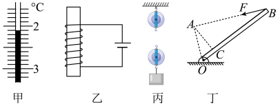

# Physics - 题目 1028

**ID**: de0095d22126411e8b836772d08ba4db
**年级**: Grade 9
**难度**: Easy
**题型**: Comprehensive

## 题目
（1）如图甲所示，温度计的示数为°C。​​​​​​​‌（2）如图乙所示，通电螺线管的上端为极。（3）站在地上的人用如图丙所示滑轮组提升重物，请画出人向下拉绳时滑轮组的绕线。（4）图丁所示，OB是以O点为支点的杠杆，F是作用在杠杆B端的力，图中线段AB与力F的作用线在一条直线上，且OA⊥AB、AC⊥OB。线段表示力F的力臂。

## 解答

1. （1）此温度计的分度值为0.1℃，数值向下增大，所以读数为-2.1℃。
2. （2）右手握住通电螺线管，四指指向电流的方向，那么大拇指所指的那一端是通电螺线管的N极，据此判断通电螺线管下端为N极，则上端为S极。
3. （3）人站在地面拉动绳子，因此绳子的拉动方向应向下，因此确定自由端的绳子，然后依次向内绕。
4. 
5. （4）由图可知，OA是从支点到力F作用线的距离，所以，OA表示力F的力臂。

## 知识点

**中文**:
  - 力和力臂的作图
  - 滑轮组的设计与组装
  - 温度计的使用与读数
  - 安培定则及其应用

**English**:
  - Drawing Force and Moment Arm Diagrams
  - Design and Assembly of Pulley Systems
  - Using and Reading Thermometers
  - Ampere's Rule and Applications

---
