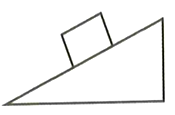

# Physics - 题目 422

**ID**: 177465d40e264102a97eb0c01ec89ad0
**年级**: Grade 9
**难度**: Easy
**题型**: Drawing

## 题目
一个物块沿着斜面向下运动，请你画出物块受到的重力和滑动摩擦力的示意图．(     )​​​​​​​‌

## 解答

1. 重力的方向竖直向下；物块沿着斜面向下运动时，滑动摩擦力平行于斜面向上．重力与滑动摩擦力的作用点都画到重心上，如图：
2. 

## 知识点

**中文**:
  - 摩擦力的示意图
  - 重力示意图

**English**:
  - Friction Force Diagrams
  - Gravity Diagrams

---
