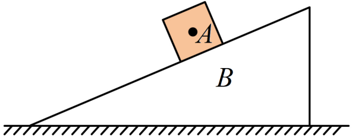

# Physics - 题目 2350

**ID**: 2ba0377c2fae4712a3a80d7ee12c681b
**年级**: Grade 9
**难度**: Easy
**题型**: Drawing

## 题目
如图，木块A和斜面B一起静止在水平桌面上，画出木块A所受重力的示意图。​​​​​​​‌

## 解答

1. 重力的作用点在受力物体的重心位置，方向竖直向下，过重心做竖直向下的带箭头的直线表示重力，并在箭头旁标注符号G。

## 知识点

**中文**:
  - 重力示意图

**English**:
  - Gravity Diagrams

---
